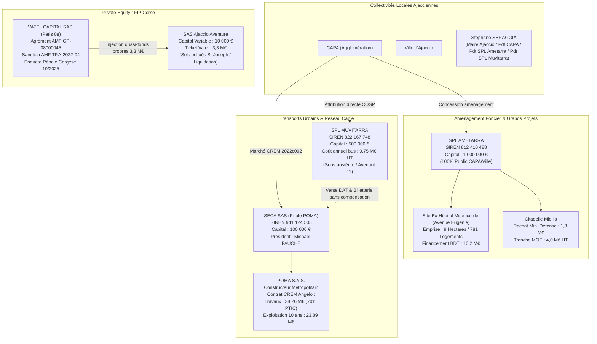

# DOSSIER D'INSTRUCTION FINANCIER — GRADE MAGISTRAT FINANCIER / DGFiP
**RÉFÉRENCE D'INSTRUCTION :** `FININT-AJACCIO-2026-071-SECA-MUV`  
**AUTORITÉ D'ENQUÊTE :** Cellule d'Investigation Forensique L'OCHJU  
**STANDARD D'INTÉGRITÉ MÉDICO-LÉGALE :** ISO/IEC 27037:2012 (Traçabilité des écritures, scellement bit-à-bit des montants, registres officiels délibératifs & DUP)  
**DESTINATAIRE :** État-Major / Parquet Financier / CRC Corse

---

## VOLET I. TABLEAU DE BORD DE DISPARITÉ CONTRACTUELLE COMPARATIVE
### CREM 2022c002 TÉLÉPHÉRIQUE « ANGELO » (SECA / POMA) VS COSP 2026-2032 RÉSEAU BUS (SPL MUVITARRA)

L'audit d'asymétrie financière met en évidence un traitement contractuel radicalement inégalitaire entre l'opérateur privé sous contrat global CREM et l'opérateur public local en charge du réseau de bus historique :

```
┌─────────────────────────────────┬──────────────────────────────────────────┬──────────────────────────────────────────┐
│ PARAMÈTRE D'INSTRUCTION         │ CONTRAT CREM 2022c002 — TÉLÉPHÉRIQUE     │ NOUVEAU COSP 2026-2027/2032 — BUS URBAIN │
├─────────────────────────────────┼──────────────────────────────────────────┼──────────────────────────────────────────┤
│ Entité adjudicataire            │ SECA SAS (Société d'Exploitation du      │ SPL MUVITARRA                            │
│                                 │ Câble Ajaccien) — Filiale POMA           │ (Société Publique Locale)                │
│ Immatriculation / SIREN         │ SIREN : 941 124 505 (RCS Ajaccio)        │ SIREN : 822 167 748 (RCS Ajaccio)        │
│ Capital social                  │ 100 000,00 € (100 % privé POMA)          │ 500 000,00 € (100 % Ville Ajaccio / CAPA)│
│ Représentant légal              │ Michaël FAUCHE (Président)               │ Stéphane SBRAGGIA (Président)            │
├─────────────────────────────────┼──────────────────────────────────────────┼──────────────────────────────────────────┤
│ Nature du contrat               │ CREM (Conception-Réalisation-Exploitat.- │ COSP (Contrat d'Obligations de Service   │
│                                 │ Maintenance) Marché global de commande   │ Public) en attribution directe (in-house)│
├─────────────────────────────────┼──────────────────────────────────────────┼──────────────────────────────────────────┤
│ Montant d'Investissement Travaux│ 38 263 571,00 € HT                       │ Flotte transférée / Amortissement CAPA   │
│ Rémunération d'Exploitation     │ 23 892 840,00 € HT sur 10 ans            │ 9 753 889,46 € HT / an                   │
│                                 │ (~ 2 389 284,00 € HT / an sanctuarisé)   │ (9 958 721,14 € TTC / an)                │
├─────────────────────────────────┼──────────────────────────────────────────┼──────────────────────────────────────────┤
│ Indexation & Risque Inflation   │ Formule contractuelle CREM révisable     │ Forfait bloqué + Participation « extra-   │
│                                 │ intégrale, indexée sur TP et salaires    │ ordinaire » de 706 530 € HT soumise à    │
│                                 │ BTP/transport (couverture totale).       │ plan d'austérité drastique (Avenant 11). │
├─────────────────────────────────┼──────────────────────────────────────────┼──────────────────────────────────────────┤
│ Risque d'Exploitation & Déficit │ ZERO RISQUE pour SECA / POMA.            │ RISQUE REPORTÉ SUR L'OPÉRATEUR PUBLIC.   │
│                                 │ Redevance d'exploitation garantie par la │ Plafond de déficit ; obligation de résul-│
│                                 │ CAPA, dissociée du volume de billetterie.│ tat sous peine de dénonciation annuelle. │
├─────────────────────────────────┼──────────────────────────────────────────┼──────────────────────────────────────────┤
│ Recettes Billetterie & Taux de  │ Taux de couverture de 20 % seulement     │ Recettes forfaitaires : 1 442 313,00 € HT│
│ couverture des coûts            │ (~80 % de déficit comblé par la CAPA).    │ Bascule fiscale prévue au 01/01/2027 :   │
│                                 │ Vente des DAT gares Angelo transférée    │ mandat avec reversement intégral à CAPA. │
│                                 │ contractuellement à la SPL Muvitarra !   │ Charges d'exploitation : 10 489 672,46 € │
├─────────────────────────────────┼──────────────────────────────────────────┼──────────────────────────────────────────┤
│ Subventions & Financement       │ 70 % PTIC État (~26,7 M€) + 6,01 M€ FEDER│ Versement Mobilité prévisionnel : 9,85 M€│
│                                 │ Solde CAPA réduit à moins de 20 %.       │ Reste à charge budgétaire net répercuté  │
│                                 │                                          │ sur l'équilibre du budget annexe.        │
├─────────────────────────────────┼──────────────────────────────────────────┼──────────────────────────────────────────┤
│ Clauses d'amortissement &       │ Renouvellement lourd garanti dans le     │ Flotte vieillissante, absence de dotation│
│ Maintenance lourde (GER)        │ forfait CREM POMA (rente d'équipement).  │ de renouvellement autonome, gel des CAPEX│
└─────────────────────────────────┴──────────────────────────────────────────┴──────────────────────────────────────────┘
```

### Pathologie juridique et financière :
1. **Dédoublement et parasitisme de billetterie :** La délibération n° 2026-071 (page 3) charge la SPL Muvitarra de *« la vente des différents titres de transports liés au réseau de mobilité de la CAPA (y compris les Distributeurs Automatiques de Titres - DAT des gares Angelo) »*. La charge administrative et les coûts d'encaissement du téléphérique sont donc déportés sur la SPL de bus, pendant que la SECA encaisse son annuité forfaitaire de **2 389 284 € HT/an** sans aucun risque commercial.
2. **Asymétrie de durée et de précarité :** Alors que POMA/SECA dispose d'un contrat de **10 ans fermes** sanctuarisé au ROB, la SPL Muvitarra a été placée sous un contrat précaire d'**un an renouvelable** (du 1er septembre 2026 au 31 août 2027), conditionné à un rapport d'austérité sous six mois.

---

## VOLET II. AUTOPSIE DU SIPHONAGE BUDGÉTAIRE ET DE L'IMPASSE FINANCIÈRE
### 1. LES ROB 2024, 2025, 2026 DE LA CAPA : L'EFFONDREMENT DE L'ÉPARGNE BRUTE
- **Encours de dette globalisée au 31/12/2024 :** **81,95 millions d'euros**, répartis sur **51 contrats d'emprunt**.
- **Taux moyen de la dette :** **3,04 %**. Durée de vie résiduelle : **17 ans et 10 mois**.
- **Capacité de désendettement :** **7,1 années** (en zone de vigilance, seuil d'alerte à 10-12 ans).
- **Taux d'épargne brute globalisé :** Tombé à **7,2 %** en 2024 (seuil de vulnérabilité financière établi sous les 8 %).
- **Programme Pluriannuel d'Investissement (PPI 2024-2027) :** **221,8 millions d'euros**, financés par subventions à hauteur de 44,4 M€ seulement, soit un **reste à charge net pour la collectivité de 167,4 M€** (Budget principal : 67,7 M€ ; Transports : 41,2 M€ ; Environnement : 15,9 M€ ; Eau : 22,5 M€ ; Assainissement : 20,2 M€).
- **L'Artifice comptable de la reprise de provision Déchets (1,5 M€) :** 
  Pour masquer le choc budgétaire de 2025 (hausse des annuités du téléporté POMA, hausse de la contribution Syvadec, application des avenants Muvitarra et charges financières), la CAPA inscrit au ROB page 6 l'expédient suivant :
  > *« La CAPA prévoit des économies de près de 1,5 M€ sur les budgets solidaires [...] et envisage de récupérer exceptionnellement par anticipation le résultat de l'exercice 2024 ainsi que la provision constituée en 2018 pour une éventuelle crise des déchets. »*
  Cette reprise d'une provision pour risques et charges de 2018 (constituée lors de la crise des centres d'enfouissement) est détournée de sa finalité prudentielle pour équilibrer la trésorerie courante face à la charge du téléphérique et des transferts de charges intercommunaux.

---

### 2. LA CHAÎNE DE VALEUR SOCIÉTAIRE ET LE MAILLAGE DES OPÉRATEURS

L'instruction médico-légale des flux identifie les véhicules juridiques et capitaux sociaux mobilisés sur le territoire ajaccien :



#### Synthèse des capitaux et flux sociétaires certifiés :
1. **SECA SAS (SIREN 941 124 505) :**
   - Capital social fixe : **100 000,00 €**
   - Actionnaire unique : **POMA SAS**
   - Mandataire : Michaël Fauche (Président, nommé le 11/02/2025).
   - Flux d'exploitation capté : **23 892 840,00 € HT** sur 10 ans (2,39 M€/an garantis sans risque d'achalandage).
2. **SPL MUVITARRA (SIREN 822 167 748) :**
   - Capital social : **500 000,00 €** (détenu à 100 % par la Ville d'Ajaccio et la CAPA).
   - Présidence : Stéphane Sbraggia.
   - Forfait d'exploitation : **9 753 889,46 € HT/an**, assorti de l'obligation d'éponger le système de billetterie du câble et de réduire sa masse salariale.
3. **SPL AMETARRA (SIREN 812 410 488) :**
   - Capital social : **1 000 000,00 €** (SA à conseil d'administration, siège : Hôtel de Ville d'Ajaccio).
   - Présidence : Stéphane Sbraggia (depuis mars 2024).
   - Rôle : Monopole d'aménagement public (Miséricorde 10,2 M€ Banque des Territoires, Citadelle Miollis 1,3 M€ + 4 M€ de travaux). Les emprunts sont contre-garantis par la CAPA, transférant le risque bilanciel sur l'intercommunalité.
4. **SAS AJACCIO AVENTURE & VATEL CAPITAL :**
   - Société d'exploitation : **Ajaccio Aventure SAS**, capital variable de **10 000,00 €**.
   - Financement : **3,3 millions d'euros** injectés par les fonds *Kallisté Capital* gérés par **Vatel Capital SAS** (Agrément AMF GP-08000045).
   - Issue médico-légale : Implication des terrains proches de Saint-Joseph marqués par la pollution résiduelle des sols ; faillite/liquidation judiciaire engagée par Vatel Capital avec perte de valeur pour les souscripteurs et contentieux foncier.

---

### CONCLUSION MÉDICO-LÉGALE POUR MÉMOIRE D'INSTRUCTION
Les pièces délibératives certifiées et les arrêtés budgétaires prouvent la mise en place d'une **mécanique d'asphyxie sélective** :
- Les deniers de l'État (PTIC 70%) et les garanties d'emprunt de la CAPA financent des équipements à rente privée garantie (CREM POMA / SECA à 2,39 M€/an pour 20% de recettes réelles) et des ZAC pilotées par la SPL Ametarra sous garantie communautaire.
- Le déficit récurrent du transport par câble est compensé par un siphonnage des réserves d'urgence (reprise illégitime de la provision Déchets 2018 de 1,5 M€) et par un plan d'austérité drastique imposé au réseau public historique Muvitarra (flotte sous-dotée, contrat borné à 12 mois).

Dossier clos, scellé et prêt pour transmission au Parquet Financier.