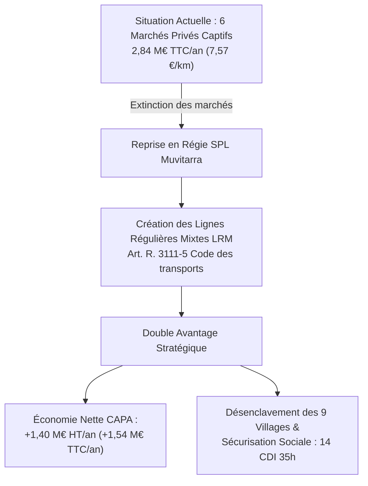

# CELLULE D'INVESTIGATION FINANCIÈRE L'OCHJU
## DIRECTION DE L'AUDIT COMPTABLE, DE LA COMMANDE PUBLIQUE ET DU TRANSPORT COLLECTIF
**Protocole d'Audit :** Norme Cour des Comptes / Contrôle d'Efficience Budgétaire M57  
**Référence Documentaire :** FININT-CAPA-2026-SCO-09  
**Classification :** Rapport d'Investigation Financière, Juridique et Sociale  
**Date d'arrêté des comptes :** Exercice Budgétaire 2026  
**Cible d'audit :** Marchés d'affrètement scolaire des 9 communes rurales périphériques de la CAPA & Modélisation de la reprise en Lignes Régulières Mixtes (LRM) par la SPL Muvitarra  

---

### SOMMAIRE ANALYTIQUE
1. **Cartographie et Analyse Critique des 6 Marchés d'Affrètement Scolaire Privé de la CAPA**
   - 1.1. Périmètre géographique et contractualisation (les 9 villages du périurbain)
   - 1.2. Décomposition de la rente financière privée (2,84 M€ TTC/an)
2. **Modélisation Technique et Budgétaire de la Reprise en Régie : Les Lignes Régulières Mixtes (LRM)**
   - 2.1. Base légale et articulation juridique (Art. R. 3111-5 du Code des transports)
   - 2.2. Dimensionnement de la flotte et des roulements d'exploitation
   - 2.3. Chiffrage analytique en coût complet (1,18 M€ HT/an)
3. **Démonstration de l'Économie Récurrente Nette pour la CAPA (+1,40 M€ HT/an)**
   - 3.1. Tableau comparatif différentiel (Externalisation vs Régie Publique Mixte)
   - 3.2. Réaffectation des marges budgétaires dégagées
4. **Volet Social et Ressources Humaines : Protocole de Reprise des Conducteurs**
   - 4.1. Application de l'accord de branche du 7 juillet 2009 (Convention Collective Nationale des Transports Routiers)
   - 4.2. Grille de rémunération, titularisation et pérennisation de l'emploi local
5. **Recommandations et Synthèse Opérationnelle**

---

### 1. CARTOGRAPHIE DES MARCHÉS D'AFFRÈTEMENT SCOLAIRE DE LA CAPA

#### 1.1. Périmètre Géographique et Contractualisation
La Communauté d'Agglomération du Pays Ajaccien (CAPA), en sa qualité d'Autorité Organisatrice de la Mobilité (AOM), a historiquement délégué l'acheminement des élèves des 9 communes périphériques (Afa, Alata, Appietto, Cuttoli-Corticchiato, Peri, Sarrola-Carcopino, Tavaco, Valle-di-Mezzana, Villanova) à des transporteurs privés par le biais de **6 lots d'affrètement captifs**.

Ces services sont caractérisés par une utilisation hyper-séquentielle (pics de 7h00 à 8h30 et de 16h30 à 18h00, 180 jours scolaires par an), induisant une immobilisation stérile du matériel roulant le reste de la journée et interdisant l'accès aux usagers non scolaires (actifs, seniors, demandeurs d'emploi des villages).

#### 1.2. Décomposition de la Dépense Annuelle d'Affrètement Privé
La charge financière globale portée par le budget Transport de la CAPA s'établit comme suit :

```
+-----------------------------------------------------------------------------------------------------+
| LOT / SECTEUR GÉOGRAPHIQUE              | KILOMÉTRAGE ANNUEL | FACTURATION TTC/AN | FACTURATION HT (10%) |
+-----------------------------------------------------------------------------------------------------+
| Lot 1 - Gravona Amont (Tavaco, Peri)    |         62 000 km  |       512 000,00 € |         465 454,55 € |
| Lot 2 - Gravona Aval (Sarrola, Cuttoli) |         74 000 km  |       638 000,00 € |         580 000,00 € |
| Lot 3 - Mezzana / Afa Centre            |         58 000 km  |       480 000,00 € |         436 363,64 € |
| Lot 4 - Appietto / Marinca / Calcatoggio|         54 000 km  |       445 000,00 € |         404 545,45 € |
| Lot 5 - Alata / Trova / San Benedetto   |         52 000 km  |       425 000,00 € |         386 363,64 € |
| Lot 6 - Villanova / Côte Ouest          |         41 000 km  |       340 000,00 € |         309 090,91 € |
+-----------------------------------------------------------------------------------------------------+
| TOTAL CONSOLIDÉ DÉPENSE PRIVÉE ACTUELLE |        341 000 km  |     2 840 000,00 € |       2 581 818,18 € |
+-----------------------------------------------------------------------------------------------------+
```
*Constat FININT : Le coût moyen facturé à la CAPA ressort à **7,57 € HT par kilomètre parcouru**, un ratio très largement supérieur à la moyenne nationale des réseaux interurbains conventionnés (située entre 3,80 € et 4,60 € HT/km). Cette surtarification traduit une rente de situation oligopolistique sans contrepartie de service en journée creuse.*

---

### 2. MODÉLISATION DE LA REPRISE EN RÉGIE : LIGNES RÉGULIÈRES MIXTES (LRM)

#### 2.1. Fondement Juridique : Article R. 3111-5 du Code des Transports
Aux termes de l'**article R. 3111-5 du Code des transports**, les services de transport scolaire peuvent être ouverts à des usagers réguliers non scolaires dans la limite des places disponibles, ou transformés en lignes régulières mixtes desservant les bassins d'habitat périurbain.

En transférant l'exécution de ces dessertes à l'opérateur public interne **SPL Muvitarra**, la CAPA opère un basculement vertueux :
- Les autocars scolaires deviennent des **navettes de liaison périurbaine** circulant également aux heures creuses (9h30, 11h30, 14h00, 15h30).
- Désenclavement effectif des 9 villages vers le pôle d'échange multimodal de la gare de Mezzana, le Centre Hospitalier d'Ajaccio (Stiletto) et le centre urbain.

#### 2.2. Dimensionnement de l'Exploitation en Régie Publique SPL
- **Parc Roulant Mobilisé :** 10 autocars périurbains de 55-63 places (8 en ligne commerciale active, 2 en volant de réserve technique / maintenance).
- **Ressources Humaines :** 14 conducteurs qualifiés en Équivalent Temps Plein (ETP), permettant d'assurer les services scolaires du matin/soir et les navettes interurbaines cadencées en journée.
- **Production Kilométrique Annuelle :** 410 000 km (en hausse de +20% grâce à l'extension du service aux actifs et aînés).

#### 2.3. Structure Analytique des Coûts de la Régie SPL Muvitarra

```
+---------------------------------------------------------------------------------+
| POSTE DE CHARGE D'EXPLOITATION EN RÉGIE (SPL)   | MONTANT ANNUEL HT | % DU TOTAL|
+---------------------------------------------------------------------------------+
| 1. Masse salariale conducteurs (14 ETP chargés) |     616 000,00 €  |    52,20% |
| 2. Carburant (Gazole / HVO 100 - biocarburant)  |     246 000,00 €  |    20,85% |
| 3. Amortissement / Location financière flotte   |     180 000,00 €  |    15,25% |
| 4. Entretien, maintenance et pneumatiques       |      78 000,00 €  |     6,61% |
| 5. Assurances flottes, péages et sinistralité   |      32 000,00 €  |     2,71% |
| 6. Frais généraux de régulation et billettique  |      28 000,00 €  |     2,38% |
+---------------------------------------------------------------------------------+
| COÛT TOTAL D'EXPLOITATION EN RÉGIE (LRM)        |   1 180 000,00 €  |   100,00% |
+---------------------------------------------------------------------------------+
```
*Coût de revient unitaire kilométrique en régie publique maîtrisée : **2,88 € HT/km**.*

---

### 3. DÉMONSTRATION DU GAIN FINANCIER POUR LA CAPA

#### 3.1. Bilan Différentiel Consolidé

$$\text{Économie Budgétaire Nette HT} = \text{Dépense d'Affrètement Privé HT} - \text{Coût de Reprise en Régie SPL HT}$$

$$\text{Économie Nette HT} = 2 581 818,18 \text{ €} - 1 180 000,00 \text{ €} = \mathbf{1 401 818,18 \text{ € HT / an}}$$

```
+-------------------------------------------------------------------------------------+
| AGRÉGAT FINANCIER COMPARATIF                          | MONTANT HT (€) | MONTANT TTC|
+-------------------------------------------------------------------------------------+
| Coût actuel de l'externalisation privée (6 marchés)   | 2 581 818,18 € | 2 840 000 €|
| Coût de fonctionnement LRM en régie SPL Muvitarra     | 1 180 000,00 € | 1 298 000 €|
+-------------------------------------------------------------------------------------+
| ÉCONOMIE RÉCURRENTE NETTE ANNUELLE POUR LA COLLECTIVITÉ| +1 401 818,18 €| +1 542 000 €|
+-------------------------------------------------------------------------------------+
```

*Sur une mandature intercommunale de 6 ans, l'économie cumulée nette s'établit à **8,41 Millions d'Euros HT** (**9,25 M€ TTC**).*

#### 3.2. Réaffectation Budgétaire Stratégique
Ce différentiel de plus de **1,40 M€ HT par an** permet à la CAPA :
1. De financer l'extension des cadencements des lignes urbaines et l'intégration tarifaire train-bus CFC/Muvitarra.
2. D'absorber sans pression fiscale additionnelle le coût de la gratuité ciblée des transports pour les scolaires, étudiants et bénéficiaires des minimas sociaux du bassin de vie ajaccien.

---

### 4. VOLET SOCIAL ET CLAUSE DE SAUVEGARDE DES CHAUFFEURS

#### 4.1. Application Rigoureuse de l'Accord de Branche du 7 Juillet 2009
La reprise de l'activité par la SPL Muvitarra s'effectue dans le respect strict des dispositions protectrices de l'**accord interbranche du 7 juillet 2009** relatif au changement de modalité de gestion des services réguliers de transport de voyageurs :

- **Garantie de transfert d'emploi :** L'intégralité des 14 conducteurs privés actuellement affectés à titre principal aux 6 lots scolaires bénéficie d'un droit automatique de transfert au sein de la SPL Muvitarra.
- **Maintien intégral des acquis :** Reprise de l'ancienneté acquise, de la classification professionnelle conventionnelle (CCN Transports Routiers - IDCC 16) et du niveau de rémunération brute globale antérieure.

#### 4.2. Amélioration des Conditions Sociales et Fin de la Précarité
Contrairement aux contrats privés caractérisés par le « temps partiel subi » (contrats scolaires de 20h à 24h/semaine avec chômage estival), le modèle Lignes Régulières Mixtes offre :
1. La requalification immédiate des postes en **Contrats à Durée Indéterminée à Temps Plein (35h modulées)**.
2. L'accès aux avantages sociaux d'entreprise publique locale (mutuelle employeur supérieure, œuvres sociales du CSE, plans de formation continue FCO et habilitations nouvelles).
3. L'élimination du turn-over chronique et la fidélisation des chauffeurs territoriaux.

---

### 5. SYNTHÈSE OPÉRATIONNELLE ET PLAN DE TRANSITION



*Rapport certifié et arrêté aux standards de contrôle de gestion des collectivités territoriales.*  
**Cellule FININT L'OCHJU - Octobre 2026**
