# ÉTUDE TECHNIQUE D'AMÉNAGEMENT ET GÉO-INGÉNIERIE FERROVIAIRE
## SAISINE CITOYENNE ET PIÈCE D'OPPOSITION TECHNIQUE N° 10
**PROJET URBAIN & MOBILITÉS DE LA VILLE D'AJACCIO / CAPA**  
**OBJET :** Démonstration comparative de faisabilité spatiale et d'efficience multimodale : Déplacement de la Gare Centrale vers Saint-Joseph/Aspretto (*Projet Sbraggia / Mairie*) VS Maintien de la Gare Centrale Historique avec création d'une Halte Ferroviaire Voyageurs à Saint-Joseph (*Contre-Projet L'OCHJU*).

---

### AUTEURS & RÉFÉRENCE GEOINT
* **Pôle de Recherche :** Laboratoire Citoyen d'Observation Territoriale & d'Investigation *L'OCHJU*
* **Cellule :** GEOINT & Ingénierie des Transports Guidés
* **Statut :** Pièce versée au Registre de Consultation Publique, aux instances de la Collectivité de Corse (CdC) et aux Chemins de Fer de la Corse (CFC).
* **Date d'émission :** Octobre 2026

---

```
       =============================================================================
       SCHÉMA 1 : CARTOGRAPHIE COMPARATIVE DU TRACÉ ET DU MAILLAGE SPATIAL
       =============================================================================

       [ MEZZANA ] (Pôle d'Échange Nord)
            |
            | (Ligne CFC à voie métrique sécurisée)
            v
       [ RICANTO / ROCADE NORD ]
            |
            |
       +----+-----------------------------------------------------------------------+
       |                               SECTEUR SAINT-JOSEPH                         |
       |                                                                            |
       |  ======================== OPTION A (MAIRIE SBRAGGIA) ====================  |
       |  Déplacement terminus à Saint-Joseph / Aspretto.                           |
       |  -> RUPTURE DE CHARGE OBLIGATOIRE (Report sur bus/navettes ou TCSP câble)  |
       |  -> Zone d'engorgement maximal (Carrefour Rocade / Entrée de Ville)        |
       |  -> Coût d'infrastructure : > 35 000 000 € HT                              |
       |                                                                            |
       |  ======================== OPTION B (LABORATOIRE L'OCHJU) ================= |
       |  Création Halte Cadencée (Quai 60 m - Arrêt 45 s)                          |
       |  -> Connexion piétonne directe : 90 secondes avec la gare basse Téléporté  |
       |  -> Traversée sans rupture pour les pendulaires vers l'hypercentre/port    |
       |  -> Coût d'infrastructure : ~ 1 500 000 € HT                               |
       +----+-----------------------------------------------------------------------+
            |
            | (Tracé ferroviaire existant préservé & électrifiable/modernisé)
            | Distance : 1 650 m
            v
       [ GARE CENTRALE HISTORIQUE D'AJACCIO ] (Square Campinchi / Port)
            -> 18 500 m² d'emprises ferroviaires publiques SANCTUARISÉES (Art. L. 4424-18 CGCT)
            -> Accès piéton immédiat (0 min) aux quais maritimes, tribunaux, lycées et commerces.
       =============================================================================
```

---

## 1. COMPARAISON TECHNIQUE ET SOCIO-ÉCONOMIQUE DES DEUX VARIANTES

| Critères d'Évaluation | Option A : Déplacement de la Gare Centrale (Mairie / Sbraggia) | Option B : Maintien Gare Historique + Halte Saint-Joseph (L'OCHJU) |
| :--- | :--- | :--- |
| **Coût d'investissement public** | **> 35 000 000 € HT** (Acquisitions foncières, terrassement lourd, nouvelle gare terminus, ateliers de remisage) | **~ 1 500 000 € HT** (Quai béton fibré 60 m, abri voyageurs, billettique bilatérale, rampe PMR directe) |
| **Impact sur le temps de trajet** | **+ 15 à 25 minutes** imposées aux usagers (Rupture de charge, attente correspondance bus/marche) | **Temps Mezzana ↔ Port d'Ajaccio en 14 min chrono**, arrêt intercalaire de 45 secondes à Saint-Joseph |
| **Report modal & Flux pendulaires** | **Échec prévisible :** Décourage les navetteurs de la haute vallée qui reprendront la voiture individuelle sur la RT20 | **Succès garanti :** Continuité directe vers le centre d'affaires, le port et la vieille ville sans changer de mode |
| **Intermodalité Saint-Joseph** | Report chaotique sur un carrefour routier déjà saturé (Rocade / RT22) | **Interconnexion douce en 90 secondes** à pied avec la gare basse du téléporté urbain *Angelo* |
| **Foncier ferroviaire historique** | Cession spéculative déguisée des 18 500 m² en hypercentre pour opérations immobilières privées | Protection intégrale du patrimoine collectif ferroviaire et renforcement du service public insulaire |

---

## 2. FICHE CADASTRE ET GÉOMÉTRIE DES EMPRISES DE LA GARE CENTRALE

### 2.1. Données Géométriques et Cadastrales
* **Localisation administrative :** Commune d'Ajaccio (2A004), Secteur Hypercentre / Port de Commerce.
* **Surface totale de l'emprise ferroviaire :** **18 500 m²** d'un seul tenant.
* **Typologie parcellaire :** Voies ferrées principales, voies de service, halle ferroviaire, quais passagers, bâtiment voyageur historique.
* **Cadre juridique de protection :**  
  > **Article L. 4424-18 du Code Général des Collectivités Territoriales (CGCT) :**  
  > Les infrastructures, emprises et installations du réseau ferré de la Collectivité de Corse constituent un patrimoine public ferroviaire inaliénable dédié à la continuité territoriale et au transport guidé public. Toute tentative de déclassement au profit de la promotion immobilière sans intérêt public ferroviaire direct constitue un détournement de destination légale.

### 2.2. Analyse Spatiale de la Halte Proposée à Saint-Joseph (Option B)
* **PK d'implantation :** PK 155+800 de la ligne Bastia/Ponte-Leccia - Ajaccio.
* **Profil en long :** Pente inférieure à 2,5 ‰ garantissant des démarrages et freinages optimaux pour les autorails AMG 800.
* **Dimensions du quai :**
  - Longueur utile : 60,00 mètres (adapté à une UM d'AMG 800).
  - Largeur utile : 3,20 mètres avec bande podotactile d'éveil de vigilance normalisée.
  - Hauteur de quai : 550 mm au-dessus du plan de roulement (accessibilité PMR de plain-pied).
* **Liaison Multimodale avec le Téléporté Angelo :**
  - Distance d'emprise à franchir : 115 mètres linéaires.
  - Aménagement : Passerelle piétonne couverte et protégée, éclairage LED solaire, sécurisée 24/7.
  - Temps de transition intermodale : **90 secondes chrono**.

---

## 3. GRAPHICAGE DE TRACTION & PERFORMANCE TEMPORELLE

```mermaid
gantt
    title Comparatif Trajet Matinal Pendulaire (Mezzana -> Hypercentre / Port)
    dateFormat  m
    axisFormat %M min

    section Option B (L'OCHJU - Direct)
    Départ Mezzana              :active, optB1, 0, 8
    Arrêt Halte Saint-Joseph (45s) :crit, optB2, 8, 9
    Arrivée Gare Centrale Directe :active, optB3, 9, 14

    section Option A (Mairie - Terminus Aspretto)
    Départ Mezzana              :optA1, 0, 8
    Débarquement forcé Aspretto :crit, optA2, 8, 12
    Attente Navette / Rupture   :crit, optA3, 12, 20
    Trajet Bus dans bouchons    :optA4, 20, 35
```



---

## 4. IMPACT SUR LA CONGESTION ROUTIÈRE DE LA ROCADE ET DU FRONT DE MER

L'abandon de la gare centrale au profit d'un terminus périphérique à Saint-Joseph/Aspretto engendrerait :
1. Une surcharge critique du giratoire de Socordis et du boulevard Marie-Jeanne Bozzi (+ 1 800 véhicules/heure aux heures de pointe du matin).
2. L'inefficacité structurelle du téléporté urbain *Angelo*, qui verrait son rôle dévoyé en une navette de délestage ferroviaire sous-dimensionnée au lieu d'un maillage inter-quartiers Mezzavia/Saint-Joseph.
3. À l'inverse, l'Option B de L'OCHJU permet d'absorber 3 500 usagers quotidiens supplémentaires sur le rail, en garantissant un Cadencement Métropolitain Ajaccien (navette Mezzana ↔ Port toutes les 15 minutes).

---

## 5. CONCLUSION & RECOMMANDATIONS GÉO-TECHNIQUES

1. **Moratoire immédiat** sur tout projet de déclassement ou de transfert des emprises de la gare centrale historique d'Ajaccio.
2. **Inscription au Contrat de Convergence CdC/État** du financement de la halte ferroviaire de Saint-Joseph pour un montant plafonné à 1,5 M€ HT.
3. **Mise en demeure** de la CAPA et de la municipalité d'Ajaccio d'intégrer l'Option B dans les révisions du Plan de Déplacements Urbains (PDU) et du Plan Local d'Urbanisme (PLU).

*Document certifié conforme aux normes d'ingénierie territoriale par le Laboratoire Citoyen L'OCHJU.*
