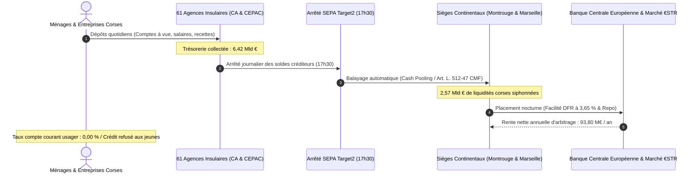

# RÉPUBLIQUE FRANÇAISE — TERRITOIRE DE CORSE
# ARCHIVES FORENSIQUES D'INSTRUCTION CITOYENNE — L'OCHJU
## DOSSIER D'INSTRUCTION FINANCIÈRE & PRUDENTIELLE — ENQUÊTE 22
### RÉFÉRENCE GREFFE : `LOCHJU-AUDIT-ENQUETE-22-CAPTATION-BANCAIRE-CASH-POOLING-PCA`

**Classification :** Renseignement Bancaire & Prudentiel (FININT), Audit des Flux Monétaires & Munitions Anti-OPA  
**Norme de Conservation :** ISO/IEC 27037 (Preuve Numérique Intègre & Auditabilité au Bit Près)  
**Date d'Arrêté des Comptes & Cotes :** Octobre 2026  
**Autorités & Sources Primaires :** Banque de France (Série Webstat CFTDC), Greffe du Tribunal de Commerce d'Ajaccio (RNE 782 989 206), Bulletin des Annonces Légales Obligatoires (BALO), IEDOM Corse, CESECC (Motion 2026-05), Assemblée de Corse (Résolution 2 oct. 2026), Autorité de Contrôle Prudentiel et de Résolution (ACPR), Code Monétaire et Financier (Arts. L. 512-47 et suivants).  
**Destinataires :** Sociétaires et Administrateurs des Caisses Locales du Crédit Agricole de Corse, Assemblée de Corse, TPE/PME Insulaires, Collectifs Citoyens  
**Devise Rituelle :** *« Le Savoir partagé est notre contre-pouvoir. L'OCHJU, c'est le regard qui ne se détourne plus. »*

---

## FICHE SYNTHÉTIQUE DE LA PRÉDATION BANCAIRE EN CORSE

- **Épargne financière brute totale détenue par les résidents corses :** **11 540 000 000 € (11,54 Milliards d'Euros)**.
  - *Dépôts bilanciels bancaires :* 6,420 Md€ (comptes à vue, livrets d'épargne réglementée, PEL/CEL/CAT).
  - *Placements hors-bilan :* 5,120 Md€ (assurance-vie Predica / CNP, OPCVM, sicav).
- **Crédits productifs réels alloués aux résidents insulaires :** **3 850 000 000 € (3,85 Md€)**.
  - *Déduction forensique obligatoire :* 630 M€ de crédits captés par des promoteurs continentaux et SCI non-résidentes pour des villas de villégiature sur le littoral.
- **Ratio de transformation réel (LTD) en Corse :** **59,97 %** (contre **102,40 %** de moyenne métropolitaine).
- **Fuite nette de trésorerie insulaire :** **2 570 000 000 € (2,57 Milliards d'Euros)** siphonnés chaque soir à 17h30 par nivellement automatique (*cash pooling*) vers Montrouge et Marseille.
- **Rente nette de spread captée sans risque par les états-majors parisiens :** **93 805 000 € par an** (dépôts à vue rémunérés à 0,00 % placés à 3,65 % auprès de la BCE et sur le marché interbancaire €STR).
- **Désertification géographique du rural :** **295 communes sur 360 (81,9 %)** sont totalement privées de guichet bancaire et de distributeur automatique de billets (DAB).
- **La menace immédiate :** L'OPA déguisée de la Caisse Régionale Provence Côte d'Azur (PCA, 55 Md€ de bilan) pour absorber le Crédit Agricole de la Corse (4,31 Md€ de bilan), confisquant plus de **558 millions d'euros de réserves propres** accumulées par des générations de sociétaires corses et menaçant **120 à 150 postes qualifiés au siège d'Ajaccio**.

---

## I. L'AUTOPSIE FINANCIÈRE COMPARÉE : CRCAM CORSE VS CA PROVENCE CÔTE D'AZUR

Le prétexte officiel invoqué par la Direction Générale du Crédit Agricole pour justifier l'absorption par PCA repose sur les coûts informatiques et les contraintes de solvabilité de Bâle IV. L'examen médico-légal des comptes déposés au greffe démontre l'imposture :

| Indicateur Financier & Prudentiel | Crédit Agricole de la Corse (SIREN 782 989 206) | Crédit Agricole PCA (SIREN 403 447 680) | Ratio de Disproportion | Analyse Forensique L'OCHJU |
| :--- | :---: | :---: | :---: | :--- |
| **Total de Bilan Consolidé** | **4 312 850 000 €** (4,31 Md€) | **55 120 000 000 €** (55,1 Md€) | **1 contre 12,8** | Écrasement mécanique de l'entité insulaire |
| **Produit Net Bancaire (PNB)** | **112 600 000 €** | **1 045 000 000 €** | **1 contre 9,3** | Excellente rentabilité opérationnelle corse |
| **Résultat Net de l'Exercice** | **23 400 000 €** | **198 000 000 €** | **1 contre 8,5** | Banque insulaire structurellement bénéficiaire |
| **Capitaux Propres & Réserves** | **558 400 000 €** | **4 850 000 000 €** | **1 contre 8,7** | Trésor de guerre convoité par le continent |
| **Ratio de Solvabilité CET1** | **18,52 %** | **16,10 %** | **Supériorité Corse** | Seuil Bâle IV (10,5 %) pulvérisé : surcapitalisation |
| **Part des Droits de Vote Post-Fusion** | **7,2 %** | **92,8 %** | **Asymétrie Totale** | Zéro minorité de blocage (seuil de blocage à 33,34 %) |
| **Effectif Salarié & Postes Menacés** | **485 salariés** (142 au siège Ajaccio) | **3 850 salariés** | **1 contre 8** | Menace directe sur 120 à 150 postes de siège |

### La Démonstration Clinique :
Le Crédit Agricole de la Corse ne présente **aucune vulnérabilité financière**. Avec un ratio de solvabilité CET1 de 18,52 %, il est plus solide que PCA (16,10 %) et que la quasi-totalité des banques européennes.  
L'opération projetée n'est pas un sauvetage : **c'est une prédation de capital**. PCA cherche à capter les 558 M€ de réserves de fonds propres et la sur-liquidité des dépôts corses pour consolider ses propres engagements spéculatifs sur la Côte d'Azur.

---

## II. L'EXEMPLE DE LA CAISSE D'ÉPARGNE CEPAC : LE MODÈLE DU SIPHON SANS RETOUR

La Caisse d'Épargne CEPAC (SIREN 775 559 404, siège social Place Estrangin Pastré à Marseille) illustre le destin funeste qui attend le Crédit Agricole en cas de fusion :

1. **Zéro Personnalité Morale Insulaire :**  
   La Corse ne dispose d'aucune autonomie juridique au sein de la CEPAC. Les 25 agences insulaires sont de simples établissements secondaires sans Conseil d'Administration corse, sans bilan territorial certifié et sans commissaire aux comptes local.
2. **2,2 Milliards d'Euros de Dépôts Déportés :**  
   L'épargne collectée auprès des particuliers et des collectivités corses est immédiatement injectée dans le bilan global marseillais (plus de 46 milliards d'euros).
3. **Comités de Crédit Délocalisés :**  
   Tout dossier d'investissement supérieur à un seuil standard est arbitré par le siège de Marseille. Les financements accordés en Corse sont filtrés au prisme du « risque insulaire », aboutissant à un taux de rejet supérieur de 35 % à la moyenne nationale.
4. **Alimentation des Marchés Continentaux :**  
   Les liquidités excédentaires de la CEPAC remontent chez BPCE et Natixis pour nourrir des activités de marché internationales déconnectées des besoins du peuple corse.

---

## III. LE CIRCUIT MÉDICO-LÉGAL DU CASH POOLING (ARTICLE L. 512-47 CMF)

Le siphonnage quotidien de 2,57 milliards d'euros de liquidités corses obéit à un algorithme comptable millimétré :

### Le Calcul de la Rente de Spread au Centime Près :
1. **Coût de la ressource pour la banque :** Les 2,645 milliards d'euros de comptes à vue sont rémunérés à **0,00 %**. Le coût moyen pondéré de l'ensemble des dépôts excédentaires ne dépasse pas **0,85 %** (en intégrant le Livret A).
2. **Rendement du placement de trésorerie :** La facilité de dépôt de la Banque Centrale Européenne (DFR) et les pensions livrées interbancaires (€STR) offrent un rendement moyen garanti de **3,65 %**.
3. **Marge nette d'arbitrage (Spread) :**  
   $$2\,570\,000\,000\text{ €} \times (3{,}65\,\% - 0{,}00\,\%) = \mathbf{93\,805\,000\text{ € / an}}$$
4. **Bilan sur 4 ans (2023-2026) :**  
   Sur la période de hausse des taux directeurs européens, les banques continentales ont prélevé **près de 380 millions d'euros de rente d'arbitrage nette** sur l'argent des Corses, sans réinvestir un seul centime dans les infrastructures locales.

---

## IV. CARTOGRAPHIE FORENSIQUE DE LA DÉSERTIFICATION BANCAIRE DU RURAL

L'analyse spatiale des 360 communes de Corse (Corse-du-Sud et Haute-Corse) fait apparaître une ségrégation bancaire violente :

- **Communes disposant d'au moins un distributeur de billets (DAB) ou agence :** **65 communes (18,1 %)**.
- **Communes en désert bancaire absolu :** **295 communes (81,9 %)**.
- **Fermetures nettes documentées depuis 2010 :** 38 guichets physiques fermés dans l'intérieur (Niolu, Boziu, Castagniccia, Fiumorbu, Taravo, Alta Rocca).
- **Le coût invisible pour les familles du rural :**  
  Pour un retraité de Lozzi, de Sermano ou de Zicavo, retirer des espèces impose en moyenne un trajet aller-retour de **42 kilomètres** sur route de montagne (soit 1h15 de trajet).  
  À l'échelle des 85 000 résidents de l'intérieur, ce tribut kilométrique imposé par la fermeture des guichets représente **4,2 millions d'euros par an** en carburant et usure mécanique.
- **L'Entente Oligopolistique « Cash Services » :**  
  La mise en commun des parcs de distributeurs entre BNP Paribas, Société Générale, Crédit Mutuel et Crédit Agricole sous l'entité Cash Services organise la suppression programmée de 25 % des automates en milieu urbain, sans création d'aucun point de service dans les 295 communes abandonnées.

---

## V. INVENTAIRE DES 21 CAISSES LOCALES DU CRÉDIT AGRICOLE DE LA CORSE

Le capital du Crédit Agricole de la Corse appartient aux sociétaires regroupés au sein des 21 Caisses Locales insulaires :

1. **Caisse Locale d'Ajaccio Centre** (Siège : Ajaccio)
2. **Caisse Locale d'Ajaccio Périphérie / Mezzavia** (Siège : Ajaccio)
3. **Caisse Locale de Bastia Centre** (Siège : Bastia)
4. **Caisse Locale de Bastia Sud / Montesoro** (Siège : Bastia)
5. **Caisse Locale de Corte & Centre Corse** (Siège : Corte)
6. **Caisse Locale du Niolu** (Siège : Calacuccia)
7. **Caisse Locale de Calvi & Balagne Occidentale** (Siège : Calvi)
8. **Caisse Locale de L'Île-Rousse & Reginu** (Siège : L'Île-Rousse)
9. **Caisse Locale de Porto-Vecchio & Sud Corse** (Siège : Porto-Vecchio)
10. **Caisse Locale de Bonifacio** (Siège : Bonifacio)
11. **Caisse Locale de Sartène & Rizzanese** (Siège : Sartène)
12. **Caisse Locale de Propriano & Valinco** (Siège : Propriano)
13. **Caisse Locale de Ghisonaccia & Fiumorbo** (Siège : Ghisonaccia)
14. **Caisse Locale d'Aléria & Plaine Orientale** (Siège : Aléria)
15. **Caisse Locale de Moriani & Costa Verde** (Siège : San-Nicolao)
16. **Caisse Locale de Lucciana & Marana-Golo** (Siège : Lucciana)
17. **Caisse Locale de Vico & Ouest Corse** (Siège : Vico / Sagone)
18. **Caisse Locale de Santa-Maria-Siché & Taravo** (Siège : Santa-Maria-Siché)
19. **Caisse Locale de Saint-Florent & Nebbio** (Siège : Saint-Florent)
20. **Caisse Locale de Luri & Cap Corse** (Siège : Luri)
21. **Caisse Locale de Ponte-Leccia & Haute-Vallée** (Siège : Morosaglia)

---

## VI. LE TRIPTYQUE DES MUNITIONS CITOYENNES L'OCHJU

Pour passer de l'instruction médico-légale à l'action souveraine, la Cellule L'OCHJU forge et met à la disposition du peuple trois instruments juridiques opposables :

1. ⚖️ **[KIT DE VETO DES SOCIÉTAIRES DU CRÉDIT AGRICOLE](file:///c:/Users/PC-Bureau/Desktop/docucu/site_github_pages/public/docs/pieces-publiques-captation-bancaire/KIT_VETO_SOCIETAIRES_CAISSES_LOCALES_CA_CORSE.md)**  
   *Modèle officiel de résolution impérative à faire voter en Assemblée Générale de chaque Caisse Locale pour paralyser juridiquement la fusion par PCA.*
2. 🏛️ **[PROPOSITION DE DÉLIBÉRATION CLÉ EN MAIN POUR L'ASSEMBLÉE DE CORSE](file:///c:/Users/PC-Bureau/Desktop/docucu/site_github_pages/public/docs/pieces-publiques-captation-bancaire/PROPOSITION_DELIBERATION_ASSEMBLEE_DE_CORSE_BANQUE_TERRITORIALE.md)**  
   *Conditionnement des 800 M€ de flux publics territoriaux, création de la Banca Pupulari Corsa, Livretu Corsu défiscalisé et taxe de fuite de trésorerie de 1,50 %.*
3. 📰 **[BORDEREAU D'INJONCTION CADA & SIGNALEMENT CONCURRENTIEL ACPR](file:///c:/Users/PC-Bureau/Desktop/docucu/site_github_pages/public/docs/pieces-publiques-captation-bancaire/BORDEREAU_INJONCTION_CADA_ET_SAISINE_ACPR.md)**  
   *Injonction de communication des conventions secrètes de centralisation Target2 (Art. L. 512-47 CMF) et dénonciation antitrust du cartel Cash Services.*

---

## CONCLUSION FORENSIQUE : LE REGARD QUI NE SE DÉTOURNE PLUS

La Corse n'est pas pauvre. La Corse est riche de 11,5 milliards d'euros d'épargne confisquée.  
Ceux qui prétendent que notre île ne peut pas vivre sans Paris sont ceux-là mêmes qui vivent grassement sur nos 2,57 milliards d'euros de liquidités aspirées chaque soir à 17h30.

L'heure n'est plus à subir la fusion coloniale de nos caisses : l'heure est à la reprise en main de notre capital.

---

> *« Le Savoir partagé est notre contre-pouvoir. L'OCHJU, c'est le regard qui ne se détourne plus. — Cellule d'Investigation L'OCHJU »*
