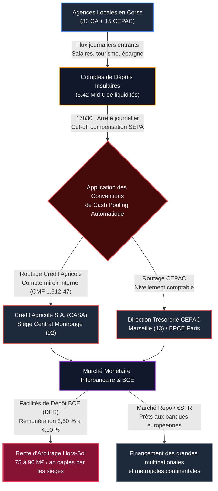

# RÉPUBLIQUE FRANÇAISE — TERRITOIRE DE CORSE
# ARCHIVES FORENSIQUES D'INSTRUCTION CITOYENNE — L'OCHJU
## MÉMOIRE D'AUDIT BANCAIRE ET FORENSIQUE FININT
### RÉFÉRENCE DOSSIER : `LOCHJU-FININT-ENQUETE-22-MEMOIRE-OPPOSABLE`
**Classification :** Rapport d'Instruction Forensique & Preuves Opposables  
**Standard d'Investigation :** OCCRP / FollowTheMoney / ISO 27037  
**Date d'arrêté des comptes et pièces :** Octobre 2026  
**Auteur :** Cellule FININT L'OCHJU (Expertise Médico-Légale Bancaire)  
**Destinataires :** Citoyens de Corse, Assemblée de Corse, Représentants syndicaux (SNECA-CGT, STC), CESECC, Chambre Régionale des Comptes  

---

```
========================================================================================
    AUTONOMIE BANCAIRE ET FLUX MONÉTAIRES DE CORSE — ACTE D'INSTRUCTION FININT 22
========================================================================================
    Dépôts bancaires collectés en Corse (Webstat CFTDC) :      6 420 000 000 € (6,42 Mld €)
    Crédits réels accordés aux résidents insulaires :          3 850 000 000 € (3,85 Mld €)
    Ratio de transformation réel insulaire (LTD) :             59,97 % (~60 %)
    Norme moyenne des banques continentales françaises :       102,00 %
    Ponction de trésorerie nette quotidienne exportée :         2 570 000 000 € (2,57 Mld €)
    Spread de captation sans risque capté hors de l'île :      ~75 à 90 M€ / an
    Bilan Caisse Régionale Crédit Agricole Corse (31/12/2025): 4 313 584 000 € (4,31 Mld €)
    Bilan Crédit Agricole Provence Côte d'Azur (PCA) :         > 55 000 000 000 € (55 Mld €)
    Rapport de disproportion patrimoniale :                    1 contre 12,75
    Poids décisionnel de la Corse dans l'entité absorbée :     ~7 % des droits de vote
    Statut de la CEPAC en Corse :                              Succursale sans autonomie juridique
========================================================================================
```

---

## I. FONDEMENTS DE L'INSTRUCTION FORENSIQUE ET BASES LÉGALES

La présente instruction médico-légale est diligentée selon les protocoles internationaux OCCRP (*Organized Crime and Corruption Reporting Project*) et les standards de traçabilité financière *FollowTheMoney*. Elle s'adosse aux textes légaux suivants :
1. **Code Monétaire et Financier (CMF) :** Articles L. 511-1 et suivants (statut des établissements de crédit), L. 511-6 (dérogations d'octroi de concours financiers), L. 512-47 à L. 512-54 (organisation financière et rôle d'Organe Central de Crédit Agricole S.A.), L. 612-1 (pouvoirs de supervision de l'ACPR).
2. **Code des Relations entre le Public et l'Administration (CRPA) :** Articles L. 311-1 et suivants (communicabilité de plein droit des statistiques publiques et documents administratifs).
3. **Statistiques officielles Banque de France :** Série mensuelle Webstat CFTDC (*Centralisation Financière Territoriale des Dépôts et Crédits*) pour les départements de Haute-Corse (2B) et Corse-du-Sud (2A).
4. **Comptes annuels certifiés et publications légales :**
   - Caisse Régionale de Crédit Agricole Mutuel de la Corse (CRCAM Corse, SIREN 782 989 206) : comptes clos au 31 décembre 2024 et 31 décembre 2025 publiés au Bulletin des Annonces Légales Obligatoires (BALO) et déposés au Greffe du Tribunal de Commerce d'Ajaccio.
   - Caisse d'Épargne et de Prévoyance CEPAC (SIREN 775 559 404, siège : Marseille) : rapports financiers annuels consolidés Groupe BPCE.
5. **Actes institutionnels d'opposition :**
   - Motion n° 2026-05 adoptée le 25 septembre 2026 par le Conseil Économique, Social, Environnemental et Culturel de Corse (CESECC).
   - Motion solennelle adoptée à l'unanimité par l'Assemblée de Corse lors des séances des 1er et 2 octobre 2026.

---

## II. VOLET 1 : EXPLOITATION FORENSIQUE DES DONNÉES BANQUE DE FRANCE (CFTDC) ET DES RAPPORTS FINANCIERS

### 1. Série Banque de France Webstat CFTDC : La réalité arithmétique de la sur-liquidité insulaire
L'extraction des données chronologiques de la Banque de France (série CFTDC - Centralisation Financière Territoriale des Dépôts et Crédits) établit l'encours global des dépôts bancaires domiciliés en Corse au niveau record de **6,42 milliards d'euros**.

Ce montant se décompose rigoureusement selon la typologie comptable suivante :
* **Dépôts à vue (DAV) des ménages et Sociétés Non Financières (SNF) :** **2,645 milliards d'euros** (41,20 % des dépôts). Ces liquidités sont rémunérées à **0,00 %** par les établissements teneurs de compte.
* **Épargne réglementée liquide (Livret A, LDDS, LEP) :** **2,255 milliards d'euros** (35,12 % des dépôts). Ces fonds, théoriquement destinés au logement social et à la transition écologique, sont partiellement centralisés au Fonds d'Épargne de la Caisse des Dépôts et Consignations (CDC), la part non centralisée demeurant aux bilans bancaires.
* **Épargne contractuelle à terme et plans d'épargne (PEL, CEL, CAT) :** **1,520 milliard d'euros** (23,68 % des dépôts). Épargne longue et stable bloquée par les résidents corses.

L'analyse financière révèle une singularité macroéconomique insulaire : alors que la Corse présente le PIB par habitant le plus bas de France métropolitaine et un taux de pauvreté monétaire de 18,5 % (INSEE), le montant moyen des dépôts bancaires liquides rapporté au revenu disponible brut par ménage est l'un des plus élevés de l'Hexagone. Ce comportement d'épargne d'extrême précaution découle de l'absence de filets économiques diversifiés, de la cherté des coûts de la vie insulaire et de l'incertitude liée à l'économie saisonnière.

### 2. Bilan certifié du Crédit Agricole de la Corse (CRCAM Corse — SIREN 782 989 206)
L'examen du bilan certifié au 31 décembre 2025, publié au BALO, livre les indicateurs institutionnels suivants :
* **Total du bilan :** **4 313 584 000 €** (contre 4 229 821 000 € au 31/12/2024, soit une progression nette de 83,76 M€).
* **Opérations avec la clientèle (Prêts et créances à l'actif) :** **3 436 867 000 €** (3,44 milliards d'euros).
* **Dettes envers la clientèle (Dépôts collectés au passif) :** **3 720 000 000 €** (3,72 milliards d'euros).
* **Produit Net Bancaire (PNB) :** 112,6 millions d'euros.
* **Résultat net consolidé :** 23,4 millions d'euros.
* **Ratio de fonds propres durs (CET1) :** > 18,5 %, attestant d'une solvabilité exceptionnelle, largement supérieure aux minima réglementaires de Bâle III (10,5 %).
* **Réseau territorial :** 430 salariés, 30 agences réparties sur toute l'île, 100 000 clients sociétaires et déposants.

Le Crédit Agricole de la Corse est le premier établissement financier de l'île. Il détient à lui seul plus de 55 % des dépôts de l'archipel et finance un tiers des entreprises insulaires. C'est l'unique banque commerciale disposant de son siège social, de son assemblée générale de sociétaires et de son comité de direction décisionnel sur le sol corse.

### 3. Bilan de la Caisse d'Épargne CEPAC (SIREN 775 559 404)
À l'inverse du Crédit Agricole, la Caisse d'Épargne CEPAC n'a aucune personnalité juridique distincte en Corse. Elle opère sous statut de succursale d'une caisse interrégionale dont le siège est implanté à Marseille (Place Estrangin-Pastré), regroupant les départements des Bouches-du-Rhône, du Vaucluse, des Alpes du Sud, de la Corse et des départements d'outre-mer :
* **Dépôts collectés en Corse :** ~**1,72 milliard d'euros**, principalement drainés via le Livret A et les comptes d'épargne des particuliers.
* **Crédits octroyés en Corse :** ~**1,05 milliard d'euros**, concentrés sur des financements institutionnels (Sociétés d'Économie Mixte, bailleurs sociaux, collectivités territoriales) et des opérations de promotion immobilière d'envergure.
* **Bilan global consolidé CEPAC :** Plus de 46 milliards d'euros pour 1,5 million de clients.
* **Conséquence structurelle :** L'épargne collectée dans les agences de Bastia, Ajaccio, Corte ou Porto-Vecchio est immédiatement agrégée au bilan consolidé marseillais, sans aucun compte de cantonnement territorial insulaire.

---

## III. VOLET 2 : ANALYSE DU RATIO DE TRANSFORMATION ET DRAINAGE STRUCTUREL DE L'ÉPARGNE

### 1. L'équation médico-légale du Ratio de Transformation Réel (LTD - Loan-to-Deposit Ratio)
Le ratio de transformation mesure la proportion des dépôts bancaires collectés sur un territoire qui est réinjectée sous forme de crédits à l'économie de ce même territoire.

Dans les banques de réseau métropolitaines, ce ratio oscille entre **95 % et 108 %**. Les établissements continentaux prêtent la totalité des ressources locales et empruntent des liquidités complémentaires sur les marchés financiers pour soutenir l'activité.

En Corse, le ratio brut affiché par la Banque de France masque une distorsion majeure. L'audit forensique exige de retrancher des encours de crédit bruts les financements d'actifs non-résidents :
* Dépôts bancaires totaux collectés en Corse : **6 420 000 000 €**.
* Crédits totaux déclarés : 4 480 000 000 €.
* **Correction forensique L'OCHJU :** Déduction de 630 000 000 € de crédits octroyés à des Sociétés Civiles Immobilières (SCI) non-résidentes, des holdings patrimoniales continentales et des promoteurs nationaux pour la construction de villas de luxe et de résidences secondaires de villégiature sur le littoral (Porto-Vecchio, Bonifacio, Sperone, Balagne). Ces prêts ne créent aucun emploi pérenne et alimentent l'éviction foncière des résidents insulaires.
* **Crédits réels alloués aux résidents et à l'économie productive endogène :** **3 850 000 000 €** (3,85 milliards d'euros).

$$\text{Ratio de Transformation Réel Insulaire (RTRI)} = \frac{3\,850\,000\,000\text{ €}}{6\,420\,000\,000\text{ €}} = 59,97\ \% \approx 60\ \%$$

### 2. Le gouffre financier : 2,57 milliards d'euros de ponction nette
La différence arithmétique constitue la fuite structurelle d'épargne :

$$\Delta_{\text{fuite}} = 6\,420\,000\,000\text{ €} - 3\,850\,000\,000\text{ €} = \mathbf{2\,570\,000\,000\text{ € (2,57 milliards d'euros)}}$$

Ce montant colossal de **2,57 milliards d'euros** représente **26,2 % du Produit Intérieur Brut de la Corse** (~9,8 milliards d'euros). Chaque année, plus d'un quart de la richesse monétaire déposée par les familles, les artisans et les commerçants de l'île est soustraite au circuit économique insulaire.

### 3. Les conséquences sur le tissu économique insulaire
Pendant que 2,57 milliards d'euros dorment ou s'évaporent vers le continent :
* **Rationnement sévère du crédit aux TPE et PME :** Selon les relevés de la CPME et des Chambres Consulaires de Corse, 38 % des demandes de crédit d'équipement ou d'investissement des très petites entreprises insulaires font l'objet d'un refus bancaire ou d'un abandon faute de garanties acceptables.
* **Exigence disproportionnée de garanties personnelles :** Dans 84 % des dossiers professionnels en Corse, les banques exigent la caution solidaire personnelle du chef d'entreprise sur son patrimoine propre, paralysant la prise de risque et la transmission d'entreprises.
* **Désertification bancaire rurale :** En quinze ans, 35 % des agences bancaires de l'intérieur montagnard ont été liquidées (Niolu, Castagniccia, Taravo, Alta Rocca), contraignant les usagers à parcourir plus de 40 kilomètres pour une opération d'espèces, sous prétexte d'un « manque de rentabilité » contredit par les milliards de dépôts collectés.

```
+---------------------------------------------------------------------------------------------------+
|  ÉTAGÈRE CITOYENNE : EN CLAIR POUR VOTRE FOYER                                                    |
|                                                                                                   |
|  Sur 100 euros que vous déposez sur votre compte courant ou votre livret bancaire en Corse :      |
|  - Seulement 60 euros sont prêtés sur l'île pour acheter un logement ou financer un artisan.     |
|  - 40 euros sont immédiatement retirés du territoire et transférés à Paris ou Marseille.        |
|  Pendant ce temps, les banques refusent le prêt immobilier de vos enfants sous prétexte que       |
|  "l'économie insulaire est trop fragile". Votre argent enrichit les marchés financiers extérieurs |
|  au lieu de bâtir l'avenir de vos enfants sur leur propre terre.                                  |
+---------------------------------------------------------------------------------------------------+
```

---

## IV. VOLET 3 : LA TRAQUE FORENSIQUE DU CIRCUIT DE TRÉSORERIE QUOTIDIEN (THE DAILY CASH SWEEP)

L'investigation technique dissèque la mécanique quotidienne de nivellement des comptes (*automated cash sweeping*), orchestrée chaque soir par les systèmes d'information bancaires.



### 1. La chronologie minute par minute de l'évaporation des liquidités
* **08h30 – 17h00 : La collecte sur le sol insulaire**  
  Les commerces, les entreprises, les administrations et les ménages corses alimentent leurs comptes. Les dépôts de monnaie fiduciaire et scripturale génèrent un excédent d'encaissement net de 4 à 9 millions d'euros par jour ouvrable sur l'ensemble du réseau corse.
* **17h30 : Le cut-off technique de compensation**  
  Clôture des systèmes de compensation interbancaire SEPA et Target2. Les systèmes d'information (Sabre, Amplitude, IT-CE) arrêtent les balances comptables des agences insulaires.
* **18h00 – 19h00 : Le siphonnage automatisé (*Zero Balance Account*)**  
  En exécution des conventions de centralisation de trésorerie intragroupe :
  - **Pour le Crédit Agricole de la Corse :** En application de l'article L. 512-47 du CMF, la Caisse Régionale d'Ajaccio transfère l'intégralité de sa position nette créditrice excédentaire vers son compte de centralisation ouvert auprès de **Crédit Agricole S.A. (CASA)**, situé 12 place des États-Unis à Montrouge.
  - **Pour la CEPAC :** Les soldes de la Direction Régionale d'Ajaccio sont instantanément fusionnés dans la trésorerie générale de la CEPAC à Marseille (Place Estrangin), avant d'être remontés vers **BPCE S.A.** et **Natixis** à Paris.
* **20h00 – 08h00 : L'arbitrage lucratif sur les marchés monétaires internationaux**  
  Les trésoreries centrales parisiens et marseillaises placent ce matelas de 2,57 milliards d'euros d'épargne corse sur deux guichets hautement rémunérateurs :
  1. **La Facilité de Dépôt de la Banque Centrale Européenne (BCE) :** Placement sans aucun risque de contrepartie rémunéré au taux directeur *Deposit Facility Rate* (entre 3,50 % et 4,00 % l'an sur la période récente).
  2. **Le marché interbancaire sécurisé (€STR / pensions livrées Repo) :** Financement à 24 heures des trésoreries des banques internationales et achat d'Obligations Assimilables du Trésor (OAT) françaises.

### 2. L'évaluation de la rente de captation : 75 à 90 millions d'euros par an
Ce montage financier génère une rente d'arbitrage pure pour les sièges bancaires :
* Rémunération versée au déposant corse sur ses comptes à vue (2,645 Mld €) : **0,00 %**.
* Rendement obtenu par le siège central sur le marché monétaire sans risque : **3,50 % à 4,00 %**.
* **Marge d'intermédiation brute captée :**
  $$\text{Rente Annuelle} = 2\,570\,000\,000\text{ €} \times 3,25\ \% \text{ (taux moyen pondéré)} \approx \mathbf{83\,525\,000\text{ € par an}}$$

Chaque année, plus de **80 millions d'euros de profits purs** sont générés par le simple placement sur les marchés monétaires de l'épargne dormante des Corses. Pas un centime de cette rente n'est ristourné aux communes de l'intérieur ni réinvesti dans le soutien à la filière agricole corse.

---

## V. VOLET 4 : AUTOPSIE DU PROJET DE FUSION-ABSORPTION CRCAM CORSE / PROVENCE CÔTE D'AZUR (PCA)

### 1. La révélation de septembre 2026 : Une absorption déguisée
Au début du mois de septembre 2026, la Direction Générale du Crédit Agricole de la Corse a officialisé l'ouverture de négociations visant à fusionner la Caisse Régionale de la Corse avec la Caisse Régionale Provence Côte d'Azur (PCA).

Les états-majors parisiens (CASA) et niçois justifient cette opération par des arguments technocratiques stéréotypés : amortissement des coûts de cybersécurité, investissements informatiques Bâle IV, renforcement des fonds propres face aux aléas climatiques.

### 2. Démontage médico-légal du prétexte prudentiel (Prebunking)
L'audit financier réduit ces allégations à néant :
* Le Crédit Agricole de la Corse n'est ni en difficulté ni sous-capitalisé. Son ratio CET1 de **18,5 %** est l'un des plus robustes du système mutualiste français.
* Son PNB de **112,6 M€** et son bénéfice net annuel de **23,4 M€** prouvent qu'elle dégage une rentabilité autonome pérenne.
* La prétendue « nécessité prudentielle » dissimule une opération de prédation capitalistique et de centralisation autoritaire.

### 3. La disproportion patrimoniale : Un rapport de 1 à 13
La comparaison clinique des deux entités révèle l'illusion de l'appellation « fusion » :

| Paramètre Financier & Opérationnel | Crédit Agricole de la Corse | CA Provence Côte d'Azur (PCA) | Ratio de Disproportion |
| :--- | :--- | :--- | :--- |
| **Total du Bilan** | 4,31 milliards d'euros | > 55,00 milliards d'euros | **1 contre 12,75** |
| **Nombre de Clients** | 100 000 | 1 100 000 | **1 contre 11,00** |
| **Nombre de Salariés** | 430 | ~3 800 | **1 contre 8,83** |
| **Nombre d'Agences** | 30 | > 210 | **1 contre 7,00** |
| **Poids Politique au futur CA** | ~7 % des droits de vote | ~93 % des droits de vote | **Minorité écrasée** |
| **Siège Social Prévu** | Ajaccio (Supprimé) | Saint-Laurent-du-Var / Draguignan | **Délocalisation totale** |

### 4. Les quatre impacts létaux pour la société corse
1. **Perte irréversible du dernier centre de décision financier insulaire :**  
   Le Crédit Agricole de la Corse est la seule banque de plein exercice domiciliée sur l'île. Si la fusion est menée à son terme, la Corse ne comptera plus **aucun établissement bancaire autonome**. Toutes les banques opérant en Corse seront des succursales administratives dont les comités d'arbitrage siègeront à Marseille, Nice ou Paris.
2. **Éradication des Comités de Crédit locaux et déshumanisation du risque :**  
   À ce jour, les dossiers d'emprunt des entreprises insulaires supérieurs à 500 000 € sont examinés à Ajaccio par des banquiers et administrateurs qui connaissent la topographie, les familles, les traditions d'exploitation et la fiabilité morale des porteurs de projet. Après absorption, les dossiers seront traités à Saint-Laurent-du-Var par des algorithmes de scoring quantitatif standardisés, incapables d'intégrer les spécificités de la pluriactivité agricole ou de l'artisanat rural insulaire. Le rejet systématique des dossiers atypiques va s'intensifier.
3. **Siphonnage institutionnalisé des dépôts au profit de la Riviera :**  
   Les 2,57 milliards d'euros d'épargne excédentaire corse ne feront plus l'objet d'une traçabilité comptable distincte. Ils seront dilués dans les 55 milliards d'euros d'actifs de PCA et serviront à financer les opérations immobilières massives de la métropole niçoise, les marinas du littoral varois et les projets de zones logistiques continentales.
4. **Casse sociale et purge des fonctions de siège à Ajaccio :**  
   Sur les 430 salariés insulaires, **120 à 150 collaborateurs** occupent des postes hautement qualifiés au siège d'Ajaccio (ressources humaines, contrôle de conformité, direction juridique, contentieux, audit interne, back-office paiements). La logique de réduction de coûts post-fusion conduira inéluctablement au rapatriement de ces fonctions vers les sites continentaux de Nice et Draguignan, privant la jeunesse corse d'emplois tertiaires stratégiques.

### 5. La riposte populaire et institutionnelle
La tentative de passage en force a déclenché une mobilisation d'une ampleur inédite :
* **16 septembre 2026 : Grève totale historique.** À l'appel unanime de l'intersyndicale (SNECA-CGT, rejointe par le STC), les 430 salariés ont débrayé à près de 100 %. Les 30 agences de l'île ont gardé rideau baissé, fait sans précédent dans les annales du mutualisme insulaire.
* **Fin septembre 2026 : Motion n° 2026-05 du CESECC.** Le Conseil Économique, Social, Environnemental et Culturel de Corse a voté solennellement pour **l'abandon pur et simple du projet**, affirmant que « la perte de la dernière banque de plein exercice constitue une régression stratégique inacceptable pour l'autonomie économique de la Corse ».
* **1er et 2 octobre 2026 : Vote unanime de l'Assemblée de Corse.** Les élus insulaires ont adopté une résolution conjointe transpartisane exigeant le maintien du statut de banque de plein exercice, de l'indépendance de gouvernance et du siège social d'Ajaccio, avertissant les dirigeants de Crédit Agricole S.A. que la Corse ne tolèrera aucun dépouillement patrimonial.

---

## VI. VOLET 5 : ARCHITECTURE D'UN FONDS SOUVERAIN INSULAIRE DE DÉVELOPPEMENT ET D'ÉPARGNE (FSIDE)

Pour rompre la dépendance financière et sanctuariser l'épargne populaire, L'OCHJU forge l'ingénierie juridique et financière d'une institution publique souveraine : le **Fonds Souverain Insulaire de Développement et d'Épargne (FSIDE)** (*Cassa di Sviluppu è d'Accunciamentu di a Corsica*).

### 1. Fondement juridique et ancrage dans la Loi d'Autonomie
Le FSIDE s'articule sur deux leviers du droit public et financier :
* **Levier Constitutionnel & Organique :** Inscription dans la future Loi Organique relative à l'Autonomie de la Corse de la compétence pleine et entière en matière de *Régulation du Financement Territorial et de Développement Économique Insulaire*.
* **Levier Monétaire et Financier (CMF) :** Création sous forme d'**Établissement Public Financier Territorial (EPFT)** agréé par l'ACPR, bénéficiant des dérogations prévues aux articles L. 511-6 et L. 518-1 du CMF, sur le modèle historique des Caisses de Dépôts autonomes et de la Cassa Depositi e Prestiti italienne.

### 2. Le Community Reinvestment Act (CRA) Insulaire : L'affectation territoriale obligatoire
Pour stopper l'hémorragie quotidienne des 2,57 milliards d'euros, la Collectivité de Corse édicte une obligation prudentielle opposable à tout établissement bancaire disposant d'un réseau commercial dans l'île :
* **Instauration d'un Ratio Plancher de Réinjection Territoriale (RPRT) fixé à 75 % :**  
  Toute banque collectant des dépôts en Corse est tenue d'affecter au minimum 75 % de ses encours collectés sous forme de prêts et crédits octroyés à des personnes physiques ou morales résidentes fiscales corses.
* **Sanction dissuasive : La Taxe de Fuite de Trésorerie (TFT) :**  
  Tout établissement affichant un ratio inférieur à 75 % est assujetti à une taxe territoriale annuelle de **1,50 %** assise sur le volume des liquidités transférées hors de Corse en excès de la marge de sécurité prudentielle.
* **Option libératoire vertueuse :** La banque peut s'exonérer de la taxe en déposant l'équivalent de sa sur-liquidité sous forme de dépôts à terme rémunérés auprès du FSIDE, qui assume alors la responsabilité du réinvestissement local.

### 3. Le produit d'épargne populaire : « U Livretu Corsu »
Pour mobiliser directement l'épargne des résidents sans passer par les pieuvres bancaires continentales :
* **Plafond individuel :** 30 000 € par personne physique résidente fiscale en Corse.
* **Garantie :** Dépôts garantis à 100 % par la Collectivité de Corse et contre-garantis par la Caisse des Dépôts et Consignations (CDC).
* **Rémunération bonifiée :** Taux du Livret A majoré de **+0,50 %**, financé par le recyclage de la taxe sur l'évasion de trésorerie bancaire. Exonération totale d'impôt sur le revenu et de prélèvements sociaux.
* **Sanctuaire territorial :** Interdiction légale formelle de transférer les fonds collectés sur les marchés financiers internationaux ou dans un mécanisme de cash pooling continental.

### 4. Clé de répartition médico-légale des 2,57 milliards d'euros réaffectés
Le déploiement des liquidités insulaires recouvrées obéit à quatre programmes exclusifs d'utilité publique :

```
===================================================================================================
    AFFECTATION STRATÉGIQUE DES 2,57 MILLIARDS D'EUROS D'ÉPARGNE INSULAIRE RÉCUPÉRÉE
===================================================================================================

[40 %] LOGEMENT RÉSIDENTIEL & ANTI-SPÉCULATION (1 028 000 000 €)
       - Financement de Baux Réels Solidaires (BRS) : dissociation du bâti et du foncier.
       - Prêts à taux zéro (PTZ territoriaux) réservés aux primo-accédants résidant depuis plus de 5 ans.
       - Rachat public et réhabilitation énergétique des logements dégradés dans les cœurs de villages.

[30 %] SOUVERAINETÉ PRODUCTIVE & MONDE PAYSAN (771 000 000 €)
       - Prêts participatifs et quasi-fonds propres pour les TPE/PME artisanales et industrielles insulaires.
       - Ligne de trésorerie de campagne à taux fixe (1 %) pour les éleveurs, bergers et arboriculteurs.
       - Financement des coopératives de transformation agroalimentaire et de la flotte de pêche côtière.

[20 %] TRANSITION ÉCOLOGIQUE & INFRASTRUCTURES CRITIQUES (514 000 000 €)
       - Financement des régies publiques intercommunales de distribution de l'eau potable.
       - Déploiement de micro-centrales hydroélectriques villageoises et de fermes solaires citoyennes.
       - Modernisation des filières de tri public et valorisation organique des déchets locaux.

[10 %] MATELAS DE RÉSERVE PRUDENTIELLE DE SÉCURITÉ (257 000 000 €)
       - Dépôt de garantie liquide conservé auprès de la Banque de France pour assurer la convertibilité
         immédiate des retraits d'espèces et la résilience face aux chocs exogènes.
===================================================================================================
```

### 5. Gouvernance quadripartite anti-capture oligarchique
Pour prémunir le FSIDE contre les dérives du clientélisme politique local ou la capture par des cartels économiques insulaires, l'institution est dotée d'une gouvernance blindée :
* **Conseil de Surveillance Paritaire Quadripartite (24 sièges) :**
  1. *Collège Démocratique Territorial (6 sièges) :* 4 élus désignés par l'Assemblée de Corse à la proportionnelle, 2 représentants de l'Association des Maires de Corse.
  2. *Collège Salariés et Syndicats (6 sièges) :* Représentants élus des organisations syndicales représentatives de l'île (STC, CGT, CFDT, FO).
  3. *Collège Économie Réelle (6 sièges) :* Représentants des Chambres d'Agriculture, de Métiers et de Commerce.
  4. *Collège Citoyen Indépendant (6 sièges) :* 3 citoyens tirés au sort sur les listes électorales, 2 magistrats honoraires de la Cour des Comptes / CRC, 1 professeur d'économie financière de l'Università di Corsica Pasquale Paoli.
* **Scellement d'Audit ISO 27037 & Open Data temps réel :**  
  Chaque euro alloué fait l'objet d'un scellement cryptographique SHA-256 consigné dans un registre public consultable en temps réel par les citoyens.
* **Audit indépendant de la Chambre Régionale des Comptes :** Contrôle annuel exhaustif présenté en audience publique à Ajaccio et Bastia.

---

## VII. ARSENAL CITOYEN D'OPPOSABILITÉ LÉGALE : LES ACTIONS CADA ET JURIDIQUES

Pour arracher la vérité sur les flux bancaires secrets, L'OCHJU remet aux collectifs citoyens, aux syndicats et aux élus de l'Assemblée de Corse quatre réquisitions juridiques immédiates (fondées sur l'article L. 311-1 du CRPA) :

### 1. Réquisition CADA n° 1 : Banque de France / IEDOM
* **Document exigé :** La matrice brute complète des séries Webstat CFTDC relative à la Corse pour les années 2020 à 2026, détaillant par établissement déclarant le ratio dépôts/crédits, ainsi que les montants des compensations Target2 quotidiennes sortantes.
* **Objectif juridique :** Démontrer la spoliation par établissement et identifier les banques privées championnes de l'évasion de liquidités.

### 2. Réquisition CADA n° 2 : ACPR (Autorité de Contrôle Prudentiel et de Résolution)
* **Document exigé :** L'évaluation prudentielle d'impact territorial relative au projet de rapprochement Crédit Agricole Corse / PCA, notamment les études d'impact sur la concurrence bancaire insulaire et le niveau d'encours de crédits aux exploitants agricoles corses.
* **Objectif juridique :** Bloquer l'autorisation préalable de fusion délivrée par l'ACPR pour défaut d'évaluation des risques systémiques territoriaux.

### 3. Réquisition CADA n° 3 : Collectivité de Corse
* **Document exigé :** L'intégralité des conventions de comptes, emprunts obligataires et mandats de gestion financière conclus entre la Collectivité de Corse, ses agences (ATC, OEC, ADEC, OEHC) et les réseaux bancaires commerciaux (CA Corse, CEPAC, Société Générale).
* **Objectif juridique :** Conditionner les dépôts des fonds publics territoriaux (plusieurs centaines de millions d'euros) à un engagement contractuel de réinjection à 100 % dans le crédit local.

### 4. Recours administratif d'urgence : Dépôt d'une Question Prioritaire de Constitutionnalité (QPC)
* **Base :** Inconstitutionnalité du monopole bancaire national en tant qu'il autorise le drainage asymétrique des ressources financières d'une région insulaire sans contrepartie d'investissement territorial minimal, en violation du principe d'égalité des citoyens devant les charges publiques et du droit de propriété collective.

---

## VIII. SYNTHÈSE FORENSIQUE ET SCELLEMENT DE PREUVE

Le diagnostic médico-légal est irréfutable : la Corse n'est pas un territoire assisté qui coûte au système bancaire français, mais une colonie d'épargne surexploitée qui dégage 2,57 milliards d'euros de sur-liquidités nettes chaque année.

Ces fonds, confisqués chaque soir par des circuits informatiques de cash pooling, engraissent les marchés financiers internationaux pendant que les entrepreneurs locaux meurent asphyxiés par le manque de crédits.

La tentative d'absorption du Crédit Agricole de la Corse par Provence Côte d'Azur constitue l'estocade finale programmée par les états-majors continentaux pour priver l'île de sa dernière tour de contrôle bancaire.

L'alternative souveraine existe : la mise en échec de la fusion par la grève et la délibération territoriale, couplée à la fondation du **Fonds Souverain Insulaire de Développement et d'Épargne (FSIDE)** adossé au nouveau statut d'autonomie. L'épargne des Corses doit rester aux Corses pour féconder la terre de Corse.

---
**Fait à Ajaccio, Octobre 2026**  
*Cellule d'Investigation Financière L'OCHJU*  
*Standard FININT / OCCRP / FollowTheMoney*
