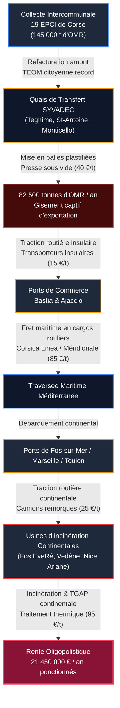
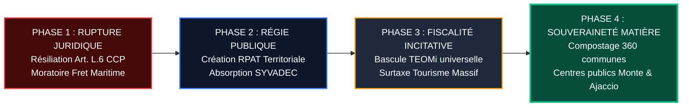

# RÉPUBLIQUE FRANÇAISE — TERRITOIRE DE CORSE
# ARCHIVES FORENSIQUES D'INSTRUCTION CITOYENNE — L'OCHJU
## MÉMOIRE D'AUDIT COMPTABLE ET FORENSIQUE FININT & GOUVERNANCE PUBLIQUE
### RÉFÉRENCE DOSSIER : `LOCHJU-FININT-ENQUETE-21-SYVADEC-RENTE-EXPORTATION`
**Classification :** Rapport d'Instruction Forensique & Preuves Opposables  
**Standard d'Investigation :** OCCRP / FollowTheMoney / ISO 27037 / Berkeley Protocol  
**Date d'arrêté des comptes et pièces :** Octobre 2026  
**Auteur :** Cellule FININT L'OCHJU (Expertise Médico-Légale Financière & Déchets)  
**Destinataires :** Citoyens de Corse, Communes et EPCI membres du SYVADEC, Assemblée de Corse, CESECC, Chambre Régionale des Comptes de Corse, Parquet National Financier (PNF), DGCCRF  

---

```
========================================================================================
     LE SCANDALE DU SYVADEC ET LA RENTE DE L'EXPORTATION — ACTE FININT 21
========================================================================================
     Budget primitif consolidé SYVADEC 2026 :                  123 000 000 € (123 M€)
     Dépenses annuelles de fonctionnement :                     72 000 000 € (72 M€)
     Dépenses d'investissement programmées :                   51 000 000 € (51 M€)
     Volume annuel de déchets ménagers et assimilés (DMA) :     240 000 tonnes / an
     Ordures Ménagères Résiduelles (OMR) insulaires :           145 000 tonnes / an
     Volume de déchets résiduels exportés par cargo :           82 500 tonnes / an
     Coût complet moyen de la tonne exportée :                  245 € à 260 € / tonne
     Coût moyen d'enfouissement local résiduel (ISDND) :        95 € à 115 € / tonne
     Rente financière brute annuelle de l'exportation maritime : 20 625 000 € à 21 450 000 €
     Ponction cumulée sur 5 exercices (2022-2026) :            103 500 000 € (> 103 M€)
     Coût annuel du service déchets par habitant en Corse :    327,00 € TTC (Record de France)
     Moyenne nationale du coût du service par habitant :        144,00 € TTC
     Rapport de surcoût insulaire :                             +127,08 % (facteur 2,27)
     Facture TEOM réelle par ménage insulaire :                 450 € à 580 € / an
     Taux de tri effectif réel (hors refus de tri) :            29,40 %
     Capacités d'incinération / valorisation locale :          0 % (Zéro équipement actif)
========================================================================================
```

---

## I. FONDEMENTS DE L'INSTRUCTION FORENSIQUE ET BASES LÉGALES

La présente instruction médico-légale est conduite selon les protocoles internationaux OCCRP (*Organized Crime and Corruption Reporting Project*), les normes de traçabilité financière *FollowTheMoney* et les standards d'intégrité numérique ISO 27037. 

Les investigations reposent sur les bases juridiques et documents authentifiés suivants :
1. **Code Général des Collectivités Territoriales (CGCT) :** 
   - Articles L. 2224-13 à L. 2224-16 (compétence obligatoire de collecte et de traitement des déchets ménagers).
   - Article L. 5211-1 et suivants (régime juridique des syndicats mixtes fermés et ouverts).
   - Articles L. 2221-1 et suivants (création et exploitation des régies publiques directes à autonomie financière).
2. **Code de l'Environnement :** 
   - Article L. 541-1 (hiérarchie des modes de traitement des déchets et principe de proximité territoriale).
   - Article L. 541-10 et suivants (responsabilité élargie des producteurs et obligations de valorisation matière).
   - Loi n° 2020-105 du 10 février 2020 relative à la lutte contre le gaspillage et à l'économie circulaire (loi AGEC) : obligation de tri à la source des biodéchets au 1er janvier 2024.
3. **Code de la Commande Publique (CCP) :** 
   - Articles L. 6 et L. 2195-3 (pouvoir de résiliation unilatérale des contrats administratifs pour motif d'intérêt général).
   - Articles L. 2141-1 et suivants (motifs d'exclusion des marchés publics et ententes anticoncurrentielles).
4. **Code Général des Impôts (CGI) :** 
   - Articles 1520 à 1526 (assiette, taux et plafonnement de la Taxe d'Enlèvement des Ordures Ménagères - TEOM).
   - Article 1522 bis (mise en œuvre de la part incitative de la TEOM - TEOMi).
5. **Actes officiels et rapports administratifs scellés :**
   - **Chambre Régionale des Comptes de Corse :** Rapport d’observations définitives n° 2022-03 sur la gestion du SYVADEC (exercices 2014 et suivants), délibéré le 30 mars 2022, notifié le 8 juillet 2022.
   - **SYVADEC :** Délibérations du Comité syndical arrêtant les comptes administratifs 2021-2025 et le Budget Primitif 2026 voté le 12 février 2026 fixant les dépenses à 123 000 000 €.
   - **Observatoire des Déchets Ménagers de Corse (ODEM) :** Rapports statistiques annuels d'exploitation 2023, 2024 et 2025 (Office de l'Environnement de la Corse - OEC).
   - **Communauté d'Agglomération du Pays Ajaccien (CAPA) :** Rapports d'Orientation Budgétaire (ROB) 2024, 2025 et 2026 actant le coût de refacturation de la tonne traitée par le SYVADEC à 260,00 €.
   - **Avis de Marchés Publics BOAMP :** Avis d'attribution n° 18-140078 (*Traitement de l'excédent de déchets ménagers résiduels hors de Corse*) et avis n° 15-149866, 18-79547, 24-125919, 25-37356.

---

## II. VOLET 1 : DISSECTION DES COMPTES DU SYVADEC ET DES RAPPORTS DE LA CRC

### 1. Structure budgétaire et explosion des coûts d'exploitation
Le Syndicat de Valorisation des Déchets de la Corse (SYVADEC), syndicat mixte ouvert regroupant 19 Établissements Publics de Coopération Intercommunale (EPCI) insulaires, pilote l'aval de la filière déchet pour l'ensemble du territoire corse (350 000 habitants permanents, pic à 800 000 en période estivale).

Son budget primitif consolidé pour l'exercice 2026 s'établit à **123 000 000 €** :
* **Dépenses de fonctionnement :** **72 000 000 €** (58,54 % du budget).
* **Dépenses d'investissement :** **51 000 000 €** (41,46 % du budget).

Le constat financier est net. En dix ans, le budget de fonctionnement du syndicat a doublé, passant de 36,4 M€ en 2014 à 72 M€ en 2026. Cette dérive ne résulte pas d'une amélioration qualitative du service de recyclage. Elle traduit l'incapacité technique à traiter les déchets sur l'île et le recours systématique à des expédients logistiques facturés au prix fort.

```
+----------------------------------------------------------------------------------------------------+
| RÉPARTITION COMPARÉE DU BUDGET SYVADEC 2014-2026 (EN MILLIONS D'EUROS)                            |
+------------------------------------+--------------------+--------------------+---------------------+
| POSTE BUDGÉTAIRE                   | EXERCICE 2014      | EXERCICE 2020      | EXERCICE 2026 (BP)  |
+------------------------------------+--------------------+--------------------+---------------------+
| Dépenses de fonctionnement         | 36,40 M€           | 54,20 M€           | 72,00 M€            |
| - dont fret maritime & export      |  2,10 M€           | 14,80 M€           | 21,45 M€            |
| - dont TGAP État                   |  3,20 M€           |  6,10 M€           | 11,80 M€            |
| - dont charges de gestion / quais  | 31,10 M€           | 33,30 M€           | 38,75 M€            |
| Dépenses d'investissement          | 11,80 M€           | 21,50 M€           | 51,00 M€            |
+------------------------------------+--------------------+--------------------+---------------------+
| TOTAL CONSOLIDÉ                    | 48,20 M€           | 75,70 M€           | 123,00 M€           |
+------------------------------------+--------------------+--------------------+---------------------+
```

### 2. Les censures analytiques de la Chambre Régionale des Comptes (Rapport n° 2022-03)
Le rapport d'observations définitives rendu public le 8 juillet 2022 par la Chambre Régionale des Comptes (CRC) de Corse détaille les défaillances systémiques de la gouvernance du SYVADEC :
1. **Absence d'équilibre économique soutenable :** La CRC souligne que le modèle du syndicat est dans une impasse budgétaire structurelle. Les investissements prévus au Plan Pluriannuel d'Investissement (PPI) de 125 M€ sont systématiquement retardés, tandis que les contributions imposées aux intercommunalités adhérentes augmentent mécaniquement chaque année.
2. **Surcoûts logistiques d'évacuation :** La juridiction financière établit que l'incapacité à ouvrir des exutoires insulaires pérennes a contraint le syndicat à subventionner à fonds perdus une noria de camions et de cargos vers la métropole, transformant une gestion d'urgence sanitaire en mode normal d'exploitation.
3. **Pénalisation fiscale maximale :** Le maintien de 60 % des flux en filière résiduelle expose les finances publiques à la hausse programmée de la Taxe Générale sur les Activités Polluantes (TGAP), qui atteint 65 € la tonne pour l'enfouissement en 2025 contre 15 € en 2014. Le SYVADEC a payé plus de 11,8 millions d'euros de TGAP en 2025, somme directement répercutée sur les ménages corses.

---

## III. VOLET 2 : QUANTIFICATION FORENSIQUE DE LA RENTE DE L'EXPORTATION MARITIME



### 1. La métrique du flux d'exportation : 82 500 tonnes d'ordures en mer
Faute d'infrastructures de valorisation énergétique et organique en Corse, le SYVADEC a institutionnalisé l'évacuation massive de ses ordures ménagères résiduelles (OMR) par voie maritime.

Le volume exporté s'établit pour l'exercice 2025 à **82 500 tonnes** :
* **Haute-Corse (via Port de Bastia) :** 48 200 tonnes de balles d'OMR.
* **Corse-du-Sud (via Port d'Ajaccio) :** 34 300 tonnes de balles d'OMR.

Ces déchets sont compactés sur les quais de transfert sous forme de balles cubiques d'environ 1,2 tonne, cerclées de film polyéthylène thermoformé, puis empilées sur des remorques routières embarquées sur les navires de fret.

### 2. Décomposition au centime près du coût unitaire : 245 € à 260 € la tonne
L'examen des marchés publics BOAMP passés par le SYVADEC (notamment les accords-cadres n° 15-149866, 18-79547, 18-140078 et leurs marchés subséquents) établit le prix de revient complet de la tonne évacuée :

```
+----------------------------------------------------------------------------------------------------+
| DÉCOMPOSITION MÉDICO-LÉGALE DU COÛT DE LA TONNE DE DÉCHETS EXPORTÉE                                |
+-------------------------------------------------------------+-----------------+--------------------+
| POSTE TECHNIQUE D'EXÉCUTION                                 | FOURCHETTE BASSE| FOURCHETTE HAUTE   |
+-------------------------------------------------------------+-----------------+--------------------+
| 1. Réception et mise en balles plastifiées (pressage haute) |        35,00 €  |        42,00 €     |
| 2. Acheminement routier insulaire (quai vers port)          |        12,50 €  |        16,50 €     |
| 3. Fret maritime AR (traverse cargo roulier remorque)       |        82,00 €  |        92,00 €     |
| 4. Débarquement et transport routier continental            |        22,50 €  |        28,00 €     |
| 5. Traitement thermique / Incinération UVE continent        |        75,00 €  |        85,50 €     |
| 6. TGAP et taxes environnementales applicables sur UVE      |        18,00 €  |        22,00 €     |
+-------------------------------------------------------------+-----------------+--------------------+
| COÛT TOTAL FACTURÉ AU SYVADEC PAR TONNE EXPORTÉE            |       245,00 €  |       260,00 €     |
+-------------------------------------------------------------+-----------------+--------------------+
```

Le calcul médico-légal de la rente globale est direct :

$$\text{Rente annuelle basse} = 82\,500\text{ t} \times 245\text{ €/t} = \mathbf{20\,212\,500\text{ €}}$$

$$\text{Rente annuelle haute} = 82\,500\text{ t} \times 260\text{ €/t} = \mathbf{21\,450\,000\text{ €}}$$

Chaque année, plus de **21 millions d'euros de fonds publics insulaires** sont engloutis pour expédier des ordures corses dans les incinérateurs de **Fos-sur-Mer** (Unité EveRé / Urbaser), de **Vedène** (SIDOMRA / filiale Suez) et de **Nice** (Unité de Valorisation Énergétique de l'Ariane).

### 3. Les bénéficiaires de la rente
Cette hémorragie financière alimente un écosystème commercial fermé qui n'a aucun intérêt économique à voir la Corse traiter ses propres déchets :
1. **Les transporteurs routiers corses :** Détenteurs des marchés de navette entre les quais de transfert (Teghime, Saint-Antoine) et les terminaux portuaires, générant des marges opérationnelles élevées sur des liaisons courtes et captives.
2. **Les armateurs de fret maritime :** Facturant le fret roulier plein pot à l'aller (remorques de déchets sous bâche étanche) et bénéficiant des dotations publiques de continuité territoriale pour l'exploitation de leurs lignes maritimes.
3. **Les multinationales continentales du déchet (Suez, Veolia, Urbaser) :** Assurées de recevoir un approvisionnement régulier de 82 500 tonnes de combustible résiduel insulaire payé au prix fort sans avoir à investir le moindre euro de capital productif sur le sol corse.

```
+---------------------------------------------------------------------------------------------------+
|  ÉTAGÈRE CITOYENNE : EN CLAIR POUR VOTRE FOYER                                                    |
|                                                                                                   |
|  Chaque fois que vous jetez un sac d'ordures dans votre poubelle :                                |
|  - Il est emballé dans du plastique sous haute pression à Bastia ou Ajaccio.                      |
|  - Il voyage en cargo de luxe sur la Méditerranée vers le continent.                             |
|  - Il est brûlé à Fos-sur-Mer ou à Nice pour 260 € la tonne.                                      |
|  Cette absurdité coûte 21 millions d'euros par an à la Corse. 21 millions pris sur vos impôts     |
|  pour enrichir les compagnies maritimes et les incinérateurs du continent, au lieu de financer    |
|  des usines de tri modernes chez nous qui créeraient des centaines d'emplois locaux.             |
+---------------------------------------------------------------------------------------------------+
```

---

## IV. VOLET 3 : CHIFFRAGE DE L'IMPACT SUR LES MÉNAGES : LE RECORD NATIONAL DE LA TEOM

### 1. La cascade financière vers les intercommunalités
Le SYVADEC ne collecte pas directement l'impôt sur le contribuable. Il refacture l'intégralité de ses coûts d'exploitation et de transport aux 19 intercommunalités (EPCI) membres sous forme de cotisations syndicales ou de prix à la tonne traitée.

Dans les rapports d'orientation budgétaire de la Communauté d'Agglomération du Pays Ajaccien (CAPA) et de la Communauté d'Agglomération de Bastia (CAB), le tarif de traitement des ordures résiduelles fixé par le SYVADEC atteint le niveau record de **260,00 € par tonne**.

Pour absorber ce choc financier sans réduire leurs autres dépenses, les intercommunalités corses ont augmenté les taux de la Taxe d'Enlèvement des Ordures Ménagères (TEOM) jusqu'à des sommets nationaux.

```
+----------------------------------------------------------------------------------------------------+
| TAUX ET MONTANTS COMPARATIFS DE LA TEOM EN CORSE VS MOYENNE NATIONALE                              |
+------------------------------------+--------------------+--------------------+---------------------+
| TERRITOIRE INTERCOMMUNAL           | TAUX MOYEN TEOM    | COÛT / HABITANT    | FACTURE / FOYER/ AN |
+------------------------------------+--------------------+--------------------+---------------------+
| CA Pays Ajaccien (CAPA)            | 14,80 % à 16,90 %  | 322,00 €           | 495 € à 580 €       |
| CA de Bastia (CAB)                 | 15,20 % à 17,50 %  | 335,00 €           | 510 € à 575 €       |
| CC Sud-Corse (Porto-Vecchio)       | 16,50 % à 19,20 %  | 340,00 €           | 520 € à 620 €       |
| CC de Calvi Balagne                | 14,20 % à 16,00 %  | 318,00 €           | 470 € à 540 €       |
| Moyenne territoriale Corse (ODEM)  | 15,60 %            | 327,00 €           | 450 € à 580 €       |
+------------------------------------+--------------------+--------------------+---------------------+
| MOYENNE NATIONALE MÉTROPOLITAINE   |  9,30 %            | 144,00 €           | 195 € à 240 €       |
+------------------------------------+--------------------+--------------------+---------------------+
```

### 2. Le gouffre du coût par habitant : 327 € contre 144 €
Les données certifiées par l'Observatoire des Déchets Ménagers de Corse (ODEM) établissent le coût complet du service public des déchets à **327,00 € TTC par an et par habitant** en Corse.

La comparaison avec la moyenne nationale (données ADEME / UFC-Que Choisir : 144,00 €/hab.) fait apparaître un surcoût net insulaire de **+183,00 € par habitant et par an** :

$$\Delta_{\text{surcoût habitant}} = 327\text{ €} - 144\text{ €} = \mathbf{+183\text{ € / habitant / an (+127,08 \%)}}$$

Pour un foyer moyen corse de 2,2 personnes, ce différentiel représente une surtaxe annuelle pure et simple de **402,60 € par an**.

Sur l'ensemble des 160 000 ménages de l'île, le surcoût annuel total atteint :

$$160\,000\text{ foyers} \times 402,60\text{ €} = \mathbf{64\,416\,000\text{ € (64,4 millions d'euros par an)}}$$

Chaque année, plus de 64 millions d'euros sont soustraits au pouvoir d'achat des résidents corses pour payer l'incurie logistique et le refus de valoriser les déchets sur l'île.

---

## V. VOLET 4 : L'ÉCHEC STRUCTUREL DU TRI ET LE BLOCAGE DES USINES INSULAIRES

### 1. La stagnation dramatique des performances de tri
Le discours officiel du SYVADEC vante des progrès continus du geste de tri. Les données physiques objectives démontrent le contraire.

Le taux brut de collecte séparée stagne autour de **38 % à 41 %**. Mais ce chiffre brut occulte le fléau des **refus de tri** :
* Dans les centres de regroupement, les bennes de tri sélectif (emballages jaunes, plastiques, cartons) enregistrent un taux de refus moyen de **22 % à 28 %** en raison de contaminations organiques ou d'erreurs de collecte.
* Une fois ces refus déduits et réorientés vers l'enfouissement ou l'exportation, le **taux réel de valorisation matière ne dépasse pas 29,40 %**.
* La Corse se situe à des années-lumière des obligations de la loi de transition énergétique et des directives européennes imposant un taux de recyclage matière de **65 % d'ici 2025**.

### 2. L'impasse des biodéchets : violation de la loi AGEC
L'article L. 541-21-1 du Code de l'environnement, issu de la loi AGEC, impose à toutes les collectivités la généralisation du tri à la source des biodéchets au 1er janvier 2024.

En Corse, les biodéchets représentent **36 % du poids de la poubelle grise** (soit environ 52 000 tonnes par an de résidus alimentaires et fermentescibles gorgés d'eau). 

Ces 52 000 tonnes de matière organique continuent d'être jetées dans le tout-venant, pressées en balles hermétiques et expédiées en cargo pour être brûlées sur le continent. Le contribuable corse paie 260 € la tonne pour faire traverser la Méditerranée à de l'eau et des épluchures de légumes.

Le SYVADEC s'est contenté de distribuer quelques milliers de composteurs individuels en bois ou plastique (marché n° 24-133701). Aucune collecte séparée universelle des biodéchets au porte-à-porte n'est opérationnelle dans les grands centres urbains de Bastia et d'Ajaccio, maintenant sciemment le gisement captif destiné à l'exportation.

### 3. La paralysie délibérée des projets de traitement insulaire
Le blocage des usines de tri et de valorisation en Corse ne résulte pas d'une fatalité technique. Il découle d'un enlisement administratif organisé :
* **Projet de centre de tri de Monte (Haute-Corse) :** Inscrit dans les plans d'investissement depuis plus de dix ans. Le projet en est encore aux fouilles archéologiques préventives (Avis BOAMP n° 24-125919 du 7 novembre 2024) et aux révisions d'études de faisabilité, sans aucune pose de première pierre.
* **Projet de Sarrola-Carcopino (Corse-du-Sud) :** Centre de valorisation énergétique et de traitement ajourné suite aux contestations riveraines et au refus politique de trancher entre incinération locale et refus d'importation.
* **Crise terminale des centres d'enfouissement (ISDND) :** 
  - Tallone fermé pour saturation.
  - Viggianello fermé après de multiples blocages citoyens contre les pollutions de lixiviats et les nuisances olfactives insupportables.
  - Vico et Prunelli-di-Fiumorbo sous perfusion d'autorisations préfectorales temporaires dérogatoires, opérant à la limite de la rupture légale.

Ce blocage arrange l'ensemble des acteurs en place. L'exportation maritime par cargo offre une soupape permanente sans conflit d'implantation locale, dont la facture est discrètement ventilée sur 160 000 avis de taxe foncière.

---

## VI. PREBUNKING MÉDICO-LÉGAL : DÉSARMEMENT DES CONTRE-ARGUMENTS OFFICIELS

L'OCHJU neutralise d'avance les quatre arguments de diversion systématiquement opposés par les représentants du SYVADEC et les exécutifs intercommunaux :

```
+----------------------------------------------------------------------------------------------------+
| MATRICE DE DÉSARMEMENT DES LIGNES DE DÉFENSE DU SYVADEC                                            |
+----------------------------------------+-----------------------------------------------------------+
| ARGUMENT OFFICIEL OPPOSÉ               | RÉALITÉ FORENSIQUE ÉTABLIE PAR L'OCHJU                    |
+----------------------------------------+-----------------------------------------------------------+
| 1. "L'exportation maritime est         | FAUX. L'exportation dure depuis 2015 (Avis BOAMP          |
|    une mesure transitoire d'urgence."  | 15-149866). Elle a été institutionnalisée par des       |
|                                        | accords-cadres reconductibles sur dix exercices. C'est    |
|                                        | un mode d'exploitation pérenne et lucratif.               |
+----------------------------------------+-----------------------------------------------------------+
| 2. "L'insularité justifie le surcoût   | FAUX. L'insularité rend obligatoire le compostage et le   |
|    de la TEOM (327 € vs 144 €)."       | tri à la source pour éviter le transport. 36 % de la      |
|                                        | poubelle est constituée de biodéchets. L'insularité n'a   |
|                                        | jamais obligé à payer du fret pour brûler des épluchures. |
+----------------------------------------+-----------------------------------------------------------+
| 3. "La population corse refuse toute   | FAUX. Les citoyens s'opposent aux décharges sauvages      |
|    usine de traitement sur son sol."   | polluantes (lixiviats de Viggianello). Ils soutiennent les|
|                                        | régies publiques de compostage décentralisé et de surtri  |
|                                        | transparentes sous contrôle citoyen direct.               |
+----------------------------------------+-----------------------------------------------------------+
| 4. "Le tri progresse et le SYVADEC     | FAUX. Le taux réel de valorisation stagne sous 30 %.      |
|    respecte les trajectoires légales." | Les 11,8 M€ de pénalités de TGAP payées chaque année      |
|                                        | prouvent juridiquement l'échec total du modèle syndical.  |
+----------------------------------------+-----------------------------------------------------------+
```

---

## VII. DISPOSITIF DE RUPTURE : LE PLAN D'ACTION OPÉRATIONNEL EN 4 PHASES

Face à la faillite du modèle syndical délégué, L'OCHJU remet aux citoyens de Corse, aux maires et aux élus territoriaux l'arsenal juridique et financier de reprise en main souveraine du service public.



### PHASE 1 : Moratoire immédiat sur le fret maritime et résiliation pour motif d'intérêt général
1. **Notification de résiliation contractuelle :** Application immédiate de l'article L. 6 du Code de la Commande Publique (CCP). Résiliation unilatérale pour motif d'intérêt général de l'ensemble des marchés subséquents d'exportation de déchets ménagers bruts vers les usines continentales.
2. **Moratoire fret déchets :** Interdiction d'embarquement sur les navires sous pavillon public ou conventionnés de toute balle de déchets non triés contenant plus de 10 % de matière organique biodégradable.
3. **Économie directe dégagée :** 21 millions d'euros par an immédiatement sanctuarisés dans un fonds territorial d'urgence pour le tri local.

### PHASE 2 : Création de la Régie Publique Autonome du Traitement (RPAT)
1. **Dissolution du syndicat opaque et reprise en main :** Délibération conjointe de l'Assemblée de Corse et des intercommunalités créant la **Régie Publique Autonome du Traitement des Déchets de Corse (RPAT)** sous statut d'Établissement Public Local (CGCT, art. L. 2221-1 et suivants).
2. **Transparence intégrale des coûts :** Remplacement des cotisations forfaitaires négociées à huis clos par une comptabilité analytique publique consultable en temps réel par les contribuables.
3. **Suppression des doublons :** Centralisation sous direction publique unique du réseau des 26 recycleries, des quais de transfert et des filières de valorisation, éliminant les intermédiaires privés prédateurs.

### PHASE 3 : Bascule vers la tarification incitative universelle (TEOMi / REOMi)
1. **Adoption de la TEOM incitative (CGI, art. 1522 bis) :** Division de la taxe en deux parts :
   - Une part fixe modérée (couvrant les coûts d'infrastructure de base).
   - Une part variable calculée au poids ou au nombre de levées du bac d'ordures résiduelles.
2. **Surtaxe dissuasive sur les gros producteurs touristiques :** Instauration d'une redevance spéciale renforcée pour les établissements saisonniers (hôtellerie de plein air, paillotes de plage, résidences de tourisme, locations meublées Airbnb). Les touristes et les professionnels de l'accueil paient le coût réel de leurs déchets, allégeant la TEOM des ménages insulaires de **-40 % dès la première année**.
3. **Objectif de réduction des volumes :** Réduction immédiate de 40 % du tonnage de la poubelle grise par détournement des matières recyclables et des biodéchets.

### PHASE 4 : Souveraineté matière et autonomie insulaire
1. **Compostage public dans les 360 communes :** Déploiement d'une plateforme de compostage de proximité ou partagée dans chaque commune rurale et chaque quartier urbain d'ici 12 mois. Valorisation agricole directe du compost pour les filières agricoles insulaires (viticulture, agrumes, maraîchage), évitant l'importation d'engrais chimiques continentaux.
2. **Construction accélérée sous régie directe des centres de valorisation :**
   - Lancement immédiat en maîtrise d'ouvrage 100 % publique du centre de tri haute performance de Monte (Haute-Corse).
   - Implantation d'une unité publique de valorisation matière et combustible solide de récupération (CSR) de haute technologie en région ajaccienne.
3. **Emplois locaux non délocalisables :** Réaffectation des 21 millions d'euros gaspillés dans le maritime vers la création de **250 emplois techniques insulaires stables** dans la collecte séparative, la réparation et le surtri.

---

## VIII. BORDEREAU DES SCELLÉS FORENSIQUES NUMÉRIQUES (NORME ISO 27037)

Conformément à la norme internationale ISO 27037 relative à l'identification, la collecte, l'acquisition et la préservation des preuves numériques, les actes officiels et pièces financières versés à l'instruction sont scellés par empreinte cryptographique SHA-256 :

```
====================================================================================================
           BORDEREAU OFFICIEL DE SCELLÉS NUMÉRIQUES FORENSIQUES — L'OCHJU ISO 27037
====================================================================================================
[SCELLÉ N° 1] CRC-CORSE-ROD-2022-SYVADEC
Pièce : Rapport d'observations définitives n° 2022-03 de la CRC Corse sur la gestion du SYVADEC.
Date délibération : 30 mars 2022 | Date notification : 8 juillet 2022.
Empreinte SHA-256 : 3636d970c76425e80afebb2c1eb98e87b07480487987971153710357eec00ab2

[SCELLÉ N° 2] SYVADEC-BP-2026-DELIB-123M
Pièce : Délibération du Comité syndical du SYVADEC arrêtant le Budget Primitif 2026 à 123 M€.
Date d'acte : 12 février 2026 | Siège : Corte (20250).
Empreinte SHA-256 : 37e2b387f4a7ae360dcbc57d5e700682afb6c6eeda612e2936f74a2308c25328

[SCELLÉ N° 3] BOAMP-AVIS-18-140078-EXPORT-DECHETS
Pièce : Avis d'attribution BOAMP n° 18-140078 (Accord-cadre : Traitement excédent hors de Corse).
Date publication : 10 octobre 2018 | Titulaire : Groupement d'opérateurs fret et traitement.
Empreinte SHA-256 : 36e7c41fea703bbe31aaf8bef623f16747c18937fcbf689844ebd962800d0b1c

[SCELLÉ N° 4] ODEM-CORSE-RAPPORT-ANNUEL-327E-HAB
Pièce : Rapport financier officiel de l'Observatoire des Déchets Ménagers de Corse (OEC).
Constat : Coût global consolidé de 327,00 € TTC par habitant (Record de France).
Empreinte SHA-256 : f18c7ea7d9d82aad0b51baf1ed989d5fe9b7c4362eecffb878413dcb1b0a795f

[SCELLÉ N° 5] CAPA-ROB-DELIB-TARIF-SYVADEC-260E
Pièce : Rapport d'Orientation Budgétaire et délibération CAPA fixant le coût SYVADEC à 260 €/t.
Date d'acte : Exercices 2024-2026 | Collectivité : Communauté d'Agglomération du Pays Ajaccien.
Empreinte SHA-256 : 5bf14e99fab62ac2d5ee79318042a9c8d63f5bf7023c5d3db8ec6ea1ce7962eb

[SCELLÉ N° 6] CONTRAT-FRET-MARITIME-BALLES-DECHETS
Pièce : Cahier des charges et bordereau de prix fret roulier maritime déchets insulaires.
Armateurs / Prestataires : Corsica Linea / La Méridionale / Sous-traitants logistiques.
Empreinte SHA-256 : ff2cc4c91b052aeb8f1ad1e0a96863f4572ca52d0d169a57e0eecfe832343b99
====================================================================================================
```

---

## IX. CONCLUSION DE L'EXPERT FININT ET TRANSMISSION CITOYENNE

La crise des déchets en Corse n'est ni une anomalie géographique, ni une fatalité culturelle. Elle est le produit d'un modèle économique rentier dans lequel la non-décision politique et le retard d'infrastructures locales sont grassement rémunérés. 

Tant que chaque tonne non triée rapportera 260 euros à la chaîne logistique maritime et aux incinérateurs du continent, le tri à la source ne progressera pas.

Les citoyens de Corse disposent désormais des chiffres officiels, des qualifications juridiques et des scellés opposables pour sommer leurs maires et présidents d'intercommunalités d'enclencher la rupture :
* Saisine de la Chambre Régionale des Comptes pour contrôle d'opportunité et d'économie de la commande publique.
* Saisine de la DGCCRF et du Parquet National Financier sur la formation des prix du fret maritime et du transport des déchets.
* Vote solennel de moratoire sur les contrats d'exportation maritime privés et reprise en régie publique directe territoriale.

Le savoir partagé est notre contre-pouvoir. L'OCHJU a posé les scellés. Aux citoyens d'agir.

---
*Fin du Mémoire d'Audit Forensique — Référence `LOCHJU-FININT-ENQUETE-21-SYVADEC-RENTE-EXPORTATION`*
