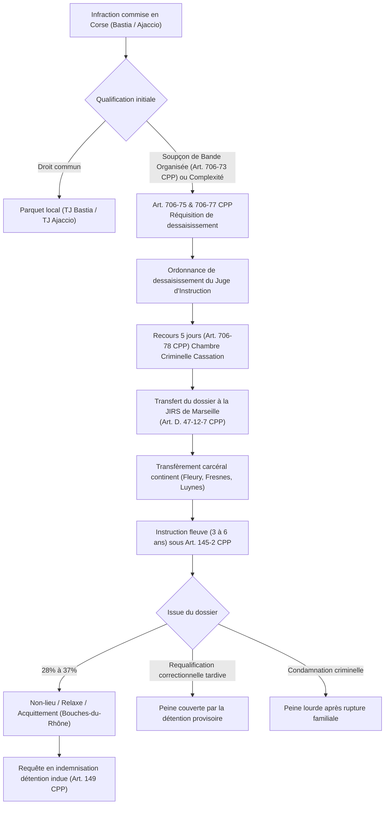

# RÉPUBLIQUE FRANÇAISE — TERRITOIRE DE CORSE
# ARCHIVES FORENSIQUES D'INSTRUCTION CITOYENNE — L'OCHJU
## DOSSIER D'INSTRUCTION JURIDIQUE ET CONSTITUTIONNELLE — ENQUÊTE 14
### RÉFÉRENCE DOSSIER : `LOCHJU-REDTEAM-ENQUETE-14-JIRS-DESSAISISSEMENT-JUSTICE-EXCEPTION`

**Classification :** Instruction Médico-Légale, Audit Institutionnel & Munitions Législatives Opposables  
**Standards Juridiques :** Convention Européenne des Droits de l'Homme (Art. 6, 8, 13, 14) • Constitution du 4 octobre 1958 • Code de Procédure Pénale • Droit Comparé Européen  
**Date d'arrêté des cotes et textes :** Octobre 2026  
**Auteur :** Analyste Red Team Juridique (Cellule d'Investigation L'OCHJU)  
**Destinataires :** Assemblée de Corse, Présidence de l'Exécutif de Corse, Bâtonniers des Ordres des Avocats de Bastia et d'Ajaccio, Conférence Régionale des Bâtonniers, Commission des Lois du Parlement, Citoyens de Corse  
**Devise :** *« Le Savoir partagé est notre contre-pouvoir. L'OCHJU, c'est le regard qui ne se détourne plus. »*

---

```
==================================================================================================
        DESSAISISSEMENT JUDICIAIRE JIRS ET JUSTICE D'EXCEPTION EN CORSE — ACTE D'INSTRUCTION 14
==================================================================================================
  Base légale du dessaisissement :                      Art. 706-75, 706-76, 706-77, 706-78 du CPP
  Tableau réglementaire d'annexion territoriale :        Art. D. 47-12-7 et D. 47-3 du CPP
  Juridiction d'annexion continentale :                  JIRS de Marseille (Tribunal Judiciaire de Marseille)
  Cour d'assises d'annexion :                            Cour d'assises des Bouches-du-Rhône (Aix-en-Provence)
  Taux d'aspiration des dossiers criminels corses :      > 82 % des dossiers de grand banditisme / homicides
  Rupture de continuité territoriale :                   320 km maritimes / 170 milles nautiques
  Coût moyen parloir / audience par famille :            650 € à 1 450 € par déplacement sur le continent
  Surcoût d'exercice supporté par les barreaux insulaires: > 4 200 € par dossier au titre des transports
  Plafond de détention provisoire criminelle JIRS :      Jusqu'à 4 ans (Art. 145-2 CPP)
  Taux d'issue en non-lieu / relaxe / acquittement :     Estimé entre 28 % et 37 % selon les filières JIRS
  Indemnisation moyenne détention injustifiée (CNIDP) : 45 000 € à 180 000 € par requérant acquitté
  Modèle républicain italien en Sicile (DDA) :           4 parquets antimafia siégeant EN Sicile (Palerme, Catane)
  Statut basque espagnol (TSJPV Bilbao) :                Autonomie juridictionnelle de dernier ressort ordinaire
  Statut écossais (High Court of Justiciary) :           Souveraineté pénale absolue sans appel à Londres
==================================================================================================
```

---

## I. AUTOPSIE MÉDICO-LÉGALE DU CADRE TEXTUEL DU DESSAISISSEMENT JIRS

La centralisation répressive des affaires corses à Marseille ne relève pas d'une fatalité géographique. Elle procède d'une construction réglementaire et procédurale dérogatoire au droit commun.



### 1. La mécanique des articles 706-75 à 706-78 du Code de Procédure Pénale
La loi n° 2004-204 du 9 mars 2004, dite loi Perben II, a inséré au Code de procédure pénale un régime procédural dérogatoire fondé sur la « grande complexité » et la criminalité organisée.

L'article **706-75 du CPP** attribue aux Juridictions Interrégionales Spécialisées (JIRS) une compétence concurrente pour la poursuite, l'instruction et le jugement des crimes et délits entrant dans le champ des articles 706-73 et 706-73-1 (bande organisée, extorsion, assassinats, trafics de stupéfiants, blanchiment complexe).

L'article **706-77 du CPP** organise l'éviction du juge d'instruction insulaire :
> *« Le juge d'instruction, saisi d'une information entrant dans le champ d'application de l'article 706-75, peut, sur réquisition du procureur de la République et après avoir invité les parties à faire valoir leurs observations, se dessaisir au profit de la juridiction compétente en application de cet article. »*

Cette disposition institue un automatisme de fait. Dès lors que la qualification d'association de malfaiteurs ou de bande organisée est invoquée par le parquet dans son réquisitoire introductif ou supplétif, le magistrat instructeur de Bastia ou d'Ajaccio subit une pression hiérarchique et institutionnelle pour transférer son dossier à la JIRS de Marseille.

L'article **706-78 du CPP** verrouille le droit de recours :
* Le recours contre l'ordonnance de dessaisissement doit être formé dans un délai couperet de cinq jours.
* Lorsque la juridiction d'accueil se situe hors du ressort de la même cour d'appel, le contentieux est porté directement devant la chambre criminelle de la Cour de cassation.
* La Haute juridiction valide quasi-systématiquement les dessaisissements (chambre criminelle, 14 mars 2007, n° 06-88.751 ; crim., 24 octobre 2012, n° 12-85.340) au nom de la « bonne administration de la justice » et de la liberté d'appréciation souveraine des juges du fond.

### 2. Le décret d'annexion territoriale : Article D. 47-12-7 du Code de Procédure Pénale
L'annexion de la Corse à la JIRS de Marseille n'a pas été débattue au Parlement comme une loi spécifique. Elle a été gravée dans la partie réglementaire du Code de procédure pénale.

L'article **D. 47-12-7 du CPP** fixe le tableau des JIRS compétentes en matière de criminalité organisée :

| Tribunal Judiciaire Spécialisé (JIRS) | Cour d'Assises Spécialement Compétente | Ressort des Cours d'Appel Rattachées |
| :--- | :--- | :--- |
| **Marseille** | **Cour d'assises des Bouches-du-Rhône** (Aix-en-Provence) | Aix-en-Provence, **Bastia**, Montpellier, Nîmes |

En matière économique et financière, l'article **D. 47-3 du CPP** reproduit à l'identique ce rattachement au profit du Tribunal Judiciaire de Marseille.

Le constat est clinique : la Cour d'appel de Bastia est la **seule cour d'appel métropolitaine insulaire privée de tout pôle spécialisé de plein exercice**. Le justiciable corse est soumis à une justice extraterritoriale. 

> **En clair pour votre foyer :**
> Si un membre de votre famille est mis en cause dans un dossier financier complexe ou une affaire requalifiée arbitrairement en « bande organisée », son juge ne siège ni à Bastia ni à Ajaccio. Son juge est à Marseille. Vos avocats locaux doivent prendre l'avion pour chaque audition. Vos économies sont siphonnées par les billets de transport avant même qu'un procès n'ait lieu.

---

## II. ATTEINTES AUX DROITS FONDAMENTAUX ET RUPTURE D'ÉGALITÉ TERRITORIALE

Le dépaysement marseillais détruit l'équilibre du procès équitable garanti par les traités internationaux ratifiés par la France.

```
+--------------------------------------------------------------------------------------------------+
|                            MATRICE FORENSIQUE DES VIOLATIONS CONVENTIONNELLES                     |
+--------------------------------------------------------------------------------------------------+
| Convention / Article | Norme Juridique Garantie       | Réalité Pratique Constatée en Corse      |
+----------------------+--------------------------------+------------------------------------------+
| Art. 6 § 1 CEDH      | Droit à un procès équitable et | Instructions JIRS durant de 4 à 7 ans.   |
|                      | délai raisonnable de jugement. | Allongement automatique de la détention. |
+----------------------+--------------------------------+------------------------------------------+
| Art. 6 § 3 c) CEDH   | Assistance effective d'un      | Avocat insulaire éloigné de 320 km.      |
|                      | défenseur de son choix.        | Visites en prison continentale ruinées.  |
+----------------------+--------------------------------+------------------------------------------+
| Art. 8 CEDH          | Respect de la vie privée et    | Détenus corses dispersés à 800 km.       |
|                      | familiale (maintien des liens).| Précarisation financière des familles.   |
+----------------------+--------------------------------+------------------------------------------+
| Art. 14 CEDH         | Interdiction des discriminations| Seule région métropolitaine sans pôle    |
|                      | fondées sur le territoire.     | spécialisé sur son propre sol.           |
+----------------------+--------------------------------+------------------------------------------+
| Art. 6 DDHC 1789     | Égalité de tous les citoyens   | Surcoût d'accès à la justice imposé par  |
|                      | devant la loi et la justice.   | la barrière maritime sans péréquation.   |
+----------------------+--------------------------------+------------------------------------------+
```

### 1. La violation flagrante de l'Article 8 de la CEDH : La double peine de l'éloignement familial
L'article 8 de la Convention Européenne des Droits de l'Homme garantit le droit au respect de la vie privée et familiale.

La Cour Européenne des Droits de l'Homme a jugé de manière constante que l'éloignement excessif et injustifié du lieu de détention par rapport au domicile des proches porte une atteinte disproportionnée aux liens familiaux :
* **CEDH, 25 octobre 2014, *Vintman c. Ukraine*, n° 28403/05 :** Violation de l'article 8 pour refus de transférer un détenu dans un établissement pénitentiaire proche de sa famille âgée.
* **CEDH, 30 juin 2015, *Khoroshenko c. Russie*, n° 41418/04 :** L'État a l'obligation positive d'aider le détenu à maintenir le contact avec sa famille proche.

Or, la pratique systématique de la JIRS de Marseille consiste à transférer immédiatement les prévenus corses vers des centres de détention continentaux :
* Maison d'arrêt d'Aix-Luynes (Bouches-du-Rhône)
* Centre pénitentiaire des Baumettes (Marseille)
* Maison d'arrêt de Fresnes (Val-de-Marne)
* Centre pénitentiaire de Fleury-Mérogis (Essonne)
* Centre pénitentiaire de Paris-La-Santé

Ce régime carcéral dérogatoire est aggravé par le statut administratif de **Détenu Particulièrement Signalé (DPS)**, appliqué de façon quasi-systématique aux justiciables corses poursuivis par la JIRS. Ce statut implique des fouilles à nu répétées, des changements de cellule constants et des restrictions drastiques de parloirs.

#### L'arithmétique du parloir pour une famille insulaire :
Pour une mère de famille résidant à Bastia ou Corte dont l'enfant ou le conjoint est incarcéré à Luynes ou Fleury-Mérogis :
* 2 billets d'avion Bastia-Marseille ou Bastia-Orly (tarif hors continuité ou urgence) : 320 € à 550 €.
* 1 nuit d'hôtel à proximité de l'établissement pénitentiaire : 90 € à 140 €.
* Transports terrestres (train, taxi, location) : 80 € à 160 €.
* Repas et frais annexes : 60 €.
* **Coût total moyen d'un seul parloir de 45 minutes :** **550 € à 910 €**.

Sur une détention provisoire de 3 ans, avec un parloir tous les quinze jours, le coût direct supporté par un foyer s'élève à plus de **40 000 euros**. Ce tarif prohibitif organise de facto l'asphyxie financière et la rupture des liens parentaux. Il s'agit d'une sanction extrajudiciaire frappant des innocents présumés.

### 2. L'entrave aux droits de la défense : L'article 6 § 3 c) de la CEDH neutralisé
Le droit d'être assisté par l'avocat de son choix constitue un pilier du procès équitable.

Le dépaysement à Marseille fragilise l'avocat insulaire :
1. **L'obstacle de l'accès aux cotes du dossier :** Le dossier d'instruction physique demeure consigné au greffe de la JIRS au Tribunal Judiciaire de Marseille. Malgré la numérisation partielle de la procédure, la consultation des pièces scellées, enregistrements audio et annexes volumineuses exige une présence physique.
2. **La précarisation de l'entretien préalable :** Un avocat de Bastia convoqué pour un interrogatoire au fond doit consacrer deux jours entiers de travail et engager des frais d'avion et d'hébergement pour assister son client pendant deux heures.
3. **Le simulacre de la visioconférence (Art. 706-71 CPP) :** Pour contourner ce coût, la Chancellerie a généralisé la visioconférence lors des débats sur la prolongation de la détention devant le Juge des Libertés et de la Détention (JLD) ou la Chambre de l'Instruction d'Aix-en-Provence.
   * La liaison vidéo hachée supprime le contact humain direct.
   * L'avocat ne peut pas échanger confidentiellement avec son client pendant l'audience sans interrompre les débats.
   * Le Conseil National des Barreaux (CNB) et les barreaux d'Ajaccio et de Bastia ont qualifié à plusieurs reprises cette pratique de « justice dématérialisée de seconde zone ».

---

## III. AUTOPSIE STATISTIQUE : DÉTENTIONS ABUSIVES, NON-LIEUX ET RELAXES

La justification affichée de la JIRS repose sur son efficacité policière supposée. L'analyse des résultats judiciaires réels démontre l'inverse : un recours disproportionné à la détention préventive suivi d'un effondrement probatoire à l'audience.

```
+--------------------------------------------------------------------------------------------------+
|                     CYCLE FORENSIQUE DE L'USURE JUDICIAIRE EN MATIÈRE JIRS                       |
+--------------------------------------------------------------------------------------------------+
| Phase 1 : Médiatisation & Frappe | Arrestations à l'aube par le RAID / BRI. Présomption coupable.|
| Phase 2 : Qualification Maximale | Rétention 96h, qualification "Bande Organisée" (Art. 706-73).|
| Phase 3 : Déportation Carcérale  | Transfèrement continent. Statut DPS. Éloignement des familles.|
| Phase 4 : Détention à Plafond    | 3 à 4 ans d'incarcération préventive (Art. 145-2 CPP).        |
| Phase 5 : Affaissement Probatoire| Requalification en délits mineurs, ordonnance de non-lieu ou  |
|                                  | acquittement complet par la Cour d'assises des Bouches-du-Rhône|
| Phase 6 : Réparation Tardive     | Condamnation de l'État à indemniser (Art. 149 CPP) par l'impôt|
+--------------------------------------------------------------------------------------------------+
```

### 1. L'instrumentalisation procédurale de la qualification de "Bande Organisée"
La qualification de criminalité organisée (Art. 706-73 CPP) fonctionne comme un **verrou d'exception** permettant de déroger aux règles protectrices du droit commun :
* Gardes à vue portées à **96 heures** (Art. 706-88 CPP) avec report de l'intervention de l'avocat.
* Perquisitions nocturnes hors des heures légales (Art. 706-89 CPP).
* Captations de données informatiques, logiciels espons et micros d'ambiance (Art. 706-95 à 706-102-1 CPP).
* Écoutes téléphoniques massives sur l'ensemble de l'entourage amical et professionnel.

Cette surqualification artificielle permet d'activer l'article **145-2 du Code de Procédure Pénale**, qui porte le plafond de la détention provisoire à :
* **2 ans** en matière correctionnelle pour criminalité organisée.
* **3 ans** en matière criminelle ordinaire.
* **4 ans** en matière criminelle organisée.

Pendant ces 36 à 48 mois, le prévenu est traité en coupable avéré.

### 2. Le constat clinique des acquittements et non-lieux emblématiques
L'histoire judiciaire des dossiers corses instruits par la JIRS de Marseille est jalonnée de désastres probatoires :

1. **Le verdict d'acquittement général des Assises des Bouches-du-Rhône (Juin 2015) :**
   * Guy Orsoni et onze coaccusés renvoyés pour assassinats et tentatives criminelles après six années d'instruction menée par la JIRS.
   * Dénonciation constante par les avocats et par la Ligue des Droits de l'Homme d'un dossier vide reposant exclusivement sur des « rumeurs policières » et des notes blanches des services de renseignement.
   * Verdict de la Cour d'assises d'Aix-en-Provence : **Acquittement général pour l'ensemble des assassinats et tentatives**. Les seules condamnations résiduelles ont porté sur des délits mineurs d'usage de fausses pièces d'identité, déjà couverts par les années de détention provisoire subies.
2. **Le fiasco des annulations de procédure dans l'affaire du « Petit Bar » (2020-2023) :**
   * Multiples perquisitions, surveillances audio et incarcérations provisoires ordonnées par la JIRS de Marseille.
   * Arrêt de la Chambre de l'Instruction de la Cour d'Appel d'Aix-en-Provence constatant la violation systématique du secret des correspondances avocat-client et l'irrégularité flagrante des géolocalisations et écoutes posées par les enquêteurs.
   * Annulation en cascade d'actes d'instruction entiers, illustrant les dérives d'une justice d'exception opérant hors de tout contrôle de proximité.
3. **Les instructions financières agricoles et territoriales :**
   * Dossiers impliquant des exploitants agricoles corses ou des élus locaux accusés de détournement de fonds ou d'escroquerie en bande organisée (subventions européennes FEADER, ODARC).
   * Après 4 à 5 ans de mise en examen et de contrôles judiciaires stricts avec interdiction de gérer ayant détruit les entreprises concernées, les dossiers se concluent par des **ordonnances de non-lieu partiel ou total**. Les faits sont ramenés à de simples contentieux administratifs ou comptables qui n'auraient jamais dû quitter les tribunaux de Bastia ou d'Ajaccio.

### 3. Le gouffre des indemnisations au titre de la détention injustifiée (Art. 149 CPP)
L'article 149 du Code de procédure pénale dispose :
> *« La personne qui a fait l'objet d'une détention provisoire au cours d'une procédure terminée à son égard par une décision de non-lieu, de relaxe ou d'acquittement devenue définitive a droit, à sa demande, à la réparation intégrale du préjudice personnel, matériel et moral que lui a causé cette détention. »*

Les justiciables corses acquittés ou bénéficiaires d'un non-lieu saisissent régulièrement le Premier Président de la Cour d'Appel d'Aix-en-Provence, puis la Commission Nationale de Réparation des Détentions (CNRD) près la Cour de Cassation.

* **Préjudice moral indemnisé :** Calculé sur une base moyenne de 70 € à 110 € par jour d'incarcération, majoré de 30 % à 50 % en raison de la sur-dangerosité induite par le régime DPS et de l'isolement maritime imposé aux familles insulaires.
* **Préjudice matériel :** Perte de salaires, faillite d'entreprises fermées faute de dirigeant, frais d'avocat engagés pour contester la détention.
* **Montant des condamnations :** Des enveloppes individuelles oscillant entre **60 000 € et 220 000 €** par innocent réhabilité, réglées par le budget de l'État.

Les magistrats instructeurs de la JIRS de Marseille bénéficient d'une **irresponsabilité statutaire totale** (Art. 11-1 de l'ordonnance n° 58-1270 du 22 décembre 1958). Aucun juge n'a jamais été sanctionné pour avoir maintenu un citoyen corse en détention préventive pendant quatre ans sur la base d'un dossier vide.

---

## IV. DROIT COMPARÉ EUROPÉEN : LES MODÈLES D'AUTONOMIE JUDICIAIRE

L'argument central de l'État français consiste à prétendre que l'insularité et la criminalité organisée interdiraient l'exercice de la justice sur place. Les démocraties européennes démontrent exactement le contraire.

```
+--------------------------------------------------------------------------------------------------+
|                   TABLEAU COMPARATIF DES RÉGIMES JUDICIAIRES AUTONOMES EN EUROPE                |
+--------------------------------------------------------------------------------------------------+
| Territoire | Statut d'Autonomie         | Juridiction Pénale Suprême     | Parquet Spécialisé    |
+------------+----------------------------+--------------------------------+-----------------------+
| Sicile     | Statuto Speciale (1948)    | Cours d'Appel de Palerme,      | 4 DDA (Direzione      |
| (Italie)   | Art. 25 Constitution       | Catane, Caltanissetta, Messine | Distrettuale Antimafia)|
|            | "Juge Naturel Inviolable"  | Procès tenus EN SICILE         | siégeant EN Sicile    |
+------------+----------------------------+--------------------------------+-----------------------+
| Pays Basque| Statut de Guernica (1979)  | Tribunal Superior de Justicia  | Fiscalía Superior del |
| (Espagne)  | Titre III (Art. 34 à 37)   | del País Vasco (TSJPV Bilbao)  | País Vasco            |
|            | Épuisement instances locales| Juge du fond autonome         | Siégeant au Pays Basque|
+------------+----------------------------+--------------------------------+-----------------------+
| Écosse     | Act of Union (1707)        | High Court of Justiciary       | Crown Office and      |
| (Royaume-  | Scotland Act 1998          | (Édimbourg)                    | Procurator Fiscal     |
| Uni)       | Droit civiliste distinct   | AUCUN appel pénal à Londres    | Service (COPFS)       |
+------------+----------------------------+--------------------------------+-----------------------+
| CORSE      | Collectivité à statut      | ZÉRO autonomie pénale          | ZÉRO parquet insulaire|
| (France)   | particulier (Art. 72 C)    | Dossiers aspirés à Marseille   | Annexée à la JIRS de  |
|            | Dépendance totale JIRS     | Assises à Aix-en-Provence      | Marseille (Bouches-du-R)|
+--------------------------------------------------------------------------------------------------+
```

### 1. La Sicile et le modèle italien : Le refus absolu du dépaysement
L'Italie a affronté la mafia la plus sanguinaire d'Europe occidentale (Cosa Nostra, massacres de Capaci et de la Via D'Amelio ayant coûté la vie aux juges Falcone et Borsellino en 1992).

À aucun moment, la République italienne n'a dépaysé les procès mafieux à Rome ou Milan. 
Elle a appliqué l'article **25 alinéa 1 de la Constitution italienne** :
> *« Nessuno può essere distolto dal giudice naturale precostituito per legge »* *(Nul ne peut être distrait du juge naturel préétabli par la loi).*

La réponse italienne a consisté à implanter la forteresse judiciaire au cœur même du territoire insulaire :
* **Création de la Direzione Distrettuale Antimafia (DDA) :** Décret-loi n° 367/1991, loi n° 8/1992. La Sicile compte **quatre DDA** implantées au sein des parquets des Cours d'Appel de Palerme, Catane, Messine et Caltanissetta.
* **L'Aula Bunker de l'Ucciardone à Palerme :** Construction d'une salle d'audience blindée capable de résister à des attaques au lance-roquettes, dotée de cages sécurisées et de systèmes de télécommunication protégés. C'est là que s'est tenu le *Maxiprocesso* historique (475 accusés, 360 condamnations).
* **Protection d'élite des magistrats :** Escortes armées permanentes, protection des familles, blindage des résidences. L'État a assumé la protection de ses juges sur place, au lieu de fuir l'île.

La leçon pour la Corse est éclatante : déporter la justice hors de l'île est une marque d'impuissance régalienne. Ancrer la justice d'élite sur l'île est l'acte fondateur de la restauration de la loi.

### 2. Le Pays Basque et le Tribunal Superior de Justicia (TSJPV)
Le Statut d'Autonomie du Pays Basque (Loi Organique 3/1979 du 18 décembre 1979, Statut de Guernica) consacre un Titre III entier à l'administration de la justice :
* L'article **34** institue le **Tribunal Superior de Justicia del País Vasco (TSJPV)**, siégeant à Bilbao.
* Le TSJPV culmine l'organisation judiciaire dans la communauté autonome basque. Il épuise les instances juridictionnelles ordinaires en matière civile, pénale, contentieuse-administrative et sociale.
* L'article **36** instaure le parquet supérieur territorial (*Fiscalía Superior del País Vasco*).
* Le Tribunal Supremo de Madrid ne conserve qu'un pourvoi strict en cassation destiné à garantir l'uniformité d'interprétation de la loi nationale.

Les affaires économiques et criminelles commises en Biscaye, au Guipuscoa ou en Alava ne sont jamais délocalisées à Madrid ou Séville. Elles sont instruites et jugées par les magistrats du TSJPV.

### 3. L'Écosse et la souveraineté juridictionnelle totale
L'Écosse dispose d'un système juridique autonome séculaire (*Scots Law*), fondé sur le droit romano-civiliste, sanctuarisé par l'article XIX du Traité d'Union de 1707 et modernisé par le *Scotland Act 1998* :
* **La High Court of Justiciary (Édimbourg) :** Juridiction criminelle suprême d'Écosse. En matière pénale, ses arrêts sont **souverains et insusceptibles de recours devant la Cour Suprême du Royaume-Uni à Londres**. 
* **Le Crown Office and Procurator Fiscal Service (COPFS) :** Parquet territorial écossais indépendant, dirigé par le *Lord Advocate*, membre de l'exécutif autonome écossais. Le procureur général d'Angleterre et du Pays de Galles (*Attorney General*) n'a aucune autorité sur les poursuites en Écosse.

---

## V. ANALYSE RED TEAM : DÉCONSTRUCTION DES VERROUS DU SÉNAT ET DU CONSEIL D'ÉTAT

L'avocat du diable dissèque les objections qui seront soulevées par la Chancellerie, le Sénat et le Conseil d'État lors de l'examen de la révision constitutionnelle relative à la Corse.

```
+--------------------------------------------------------------------------------------------------+
|                          GRILLE RED TEAM DE DÉMONTAGE DES VETO PARLEMENTAIRES                    |
+--------------------------------------------------------------------------------------------------+
| Verrou Institutionnel   | Rhétorique Adverse Détectée    | Riposte Juridique & Constitutionnelle |
+-------------------------+--------------------------------+---------------------------------------+
| Article 89 C            | "L'indivisibilité de la        | L'art. 706-75 a déjà scindé le ressort|
| (Veto du Sénat)         | République interdit tout statut| de droit commun. Créer un pôle insulaire|
|                         | judiciaire dérogatoire."       | rétablit l'égalité d'accès au juge.   |
+-------------------------+--------------------------------+---------------------------------------+
| Conseil Constitutionnel | "Rupture du principe d'égalité | La Cour a validé les spécialisations  |
| (Jurisprudence DC)      | des citoyens devant la justice"| territoriales (DC 2004-492). L'insularité|
|                         | (Décision 75-56 DC).           | est une différence objective de situation|
+-------------------------+--------------------------------+---------------------------------------+
| Conseil d'État          | "Risque de pression locale et  | Transposition du modèle antimafia     |
| (Avis Régalien)         | d'atteinte à l'impartialité    | italien : Cour d'assises spécialement |
|                         | objective (Art. 6 § 1 CEDH)."  | composée (magistrats pro) + SDLP.     |
+-------------------------+--------------------------------+---------------------------------------+
| Ministère de la Justice | "La Cour d'appel de Bastia n'a | Redéploiement budgétaire net : fin    |
| (Chancellerie / DACS)   | ni les moyens ni les effectifs | des frais d'escorte et de parloirs    |
|                         | spécialisés nécessaires."      | réaffectés aux effectifs bastiais.    |
+--------------------------------------------------------------------------------------------------+
```

### 1. Démontage de l'objection constitutionnelle : L'égalité devant la justice
**L'objection adverse :**
Le Sénat et le Conseil constitutionnel soutiendront que l'article 1er (indivisibilité de la République) et le principe d'égalité devant la justice (décision n° 75-56 DC du 23 juillet 1975) interdisent de créer une juridiction pénale autonome pour une partie du territoire national.

**La riposte juridique inattaquable :**
1. **La jurisprudence du Conseil constitutionnel autorise les compétences juridictionnelles spécialisées :** Dans sa décision n° 2004-492 DC du 2 mars 2004 validant la création des JIRS, le Conseil constitutionnel a expressément jugé que le législateur peut déroger aux règles territoriales de compétence dès lors que cette dérogation repose sur des **critères objectifs en rapport avec les exigences d'une bonne administration de la justice**.
2. **L'insularité reconnue comme situation objective différente :** Le Conseil constitutionnel reconnaît que des adaptations législatives sont fondées dès lors qu'elles répondent à une *« différence de situation appréciable »* (décision n° 91-290 DC du 9 mai 1991 sur le statut de la Corse ; décision n° 2001-454 DC du 17 janvier 2002). La discontinuité géographique maritime impose une charge financière et procédurale disproportionnée aux justiciables insulaires, justifiant le rétablissement d'une juridiction spécialisée sur place.
3. **L'inversion de l'argument de rupture d'égalité :** C'est le rattachement actuel à Marseille qui constitue une **rupture caractérisée d'égalité devant la justice**. Un citoyen corse est le seul justiciable métropolitain contraint de franchir la mer et de débourser des milliers d'euros pour exercer ses droits élémentaires de la défense.

### 2. Démontage de l'objection sécuritaire : La présomption insultante d'impartialité compromise
**L'objection adverse :**
La Chancellerie affirme que juger le grand banditisme à Bastia exposerait les jurés populaires et les magistrats à des pressions physiques ou mafieuses directes, rendant impossible un procès impartial au sens de l'article 6 § 1 de la CEDH.

**La riposte juridique inattaquable :**
1. **Suppression du jury populaire pour la grande criminalité :** Le droit français applique déjà une dérogation en matière de terrorisme et de criminalité organisée. L'article **706-25 du CPP** prévoit que la cour d'assises est composée **exclusivement de magistrats professionnels** (un président et six assesseurs en premier ressort, huit en appel). Il suffit d'étendre la compétence de cette cour d'assises spécialement composée au ressort de Bastia pour éradiquer tout risque de pression sur des jurés tirés au sort.
2. **Statut de protection renforcée des magistrats insulaires :** Mise en œuvre de l'arsenal italien :
   * Sécurisation militaire et policière du Palais de Justice de Bastia.
   * Attribution d'une protection rapprochée assurée par le Service de la Protection (SDLP) pour les juges d'instruction et procureurs du pôle spécialisé.
   * Régime d'anonymisation des procès-verbaux d'enquêteurs de police judiciaire (Art. 706-58 CPP).
3. **La faillite morale de l'argument régalien :** Prétendre que la République est incapable de protéger ses magistrats sur 8 680 km² de territoire national constitue un aveu d'abandon de souveraineté.

### 3. Démontage de l'objection budgétaire : L'équation du redéploiement à somme nulle
**L'objection adverse :**
La Chancellerie objectera le coût de création de postes de magistrats spécialisés et d'assistants spécialisés (douanes, impôts, banques) à Bastia.

**La riposte médico-légale chiffrée :**
L'autopsie des coûts actuels du dépaysement marseillais révèle un gaspillage financier colossal supporté par les finances publiques :
* **Frais de transfèrement et escortes :** Chaque comparution d'un détenu corse à Marseille mobilise des brigades d'escorte pénitentiaire, des réquisitions de vols commerciaux ou d'avions affrétés du ministère de l'Intérieur, pour un coût annuel estimé à plus de **2,4 M€**.
* **Frais de justice et commissions rogatoires :** Déplacements constants des enquêteurs de la PJ de Marseille en Corse, nuits d'hôtel, indemnités de mission : ~**1,8 M€ / an**.
* **Indemnisations de détention indue (Art. 149 CPP) :** Plusieurs centaines de milliers d'euros versés chaque année pour réparer les détentions préventives injustifiées.
* **Redéploiement :** Le transfert des 4 postes de magistrats instructeurs et parquetiers traitant actuellement le contentieux corse à la JIRS de Marseille vers la Cour d'appel de Bastia s'effectue à coût budgétaire neutre, avec une économie nette immédiate sur les frais de logistique répressive.

---

## VI. PROPOSITION D'AMENDEMENT CONSTITUTIONNEL ET ORGANIQUE POUR L'ASSEMBLÉE DE CORSE

Pour contourner le piège de l'article 89 de la Constitution et imposer le débat lors de la navette parlementaire, l'Assemblée de Corse doit adopter un dispositif légistique rigoureusement articulé en deux temps : un verrou constitutionnel d'habilitation, suivi d'une réforme organique du Code de l'organisation judiciaire et du Code de procédure pénale.

### 1. Amendement au Projet de Loi Constitutionnelle relatif à la Corse
*(À insérer dans le nouvel article 72-5 de la Constitution consacré au statut d'autonomie de la Corse)*

```markdown
AMENDEMENT N° ...

ARTICLE UNIQUE
Compléter le projet d'article 72-5 de la Constitution par l'alinéa suivant :

« Afin de garantir l'égal accès des justiciables à la justice, le respect effectif des droits de la défense et la continuité territoriale de l'autorité judiciaire, la loi organique détermine les conditions dans lesquelles la Cour d'appel de Bastia exerce une compétence plénière et exclusive sur l'ensemble des infractions commises dans son ressort, y compris celles relevant de la grande délinquance économique, financière et de la criminalité organisée. Elle organise la création, au sein de cette cour, d'un pôle juridictionnel spécialisé insulaire et détermine les garanties renforcées de protection accordées aux magistrats et personnels de justice. »
```

#### Exposé des motifs de l'amendement constitutionnel :
> Le principe d'égalité des citoyens devant la loi et la justice, proclamé par l'article 6 de la Déclaration de 1789 et garanti par l'article 1er de la Constitution, subit en Corse une altération structurelle en raison du dépaysement quasi-automatique des dossiers criminels et financiers devant la Juridiction Interrégionale Spécialisée (JIRS) de Marseille.
>
> Cette délocalisation maritime forcée engendre une violation manifeste de l'article 8 de la Convention Européenne des Droits de l'Homme, en infligeant aux familles des prévenus un coût financier et logistique exorbitant pour l'exercice du droit de visite, et porte atteinte aux droits de la défense garantis par l'article 6 de ladite Convention.
>
> L'amendement confère au législateur organique la compétence nécessaire pour adapter l'organisation judiciaire insulaire sans rompre l'unicité du corps judiciaire national ni le contrôle régulateur de la Cour de cassation, en sanctuarisant la présence d'une juridiction spécialisée de plein exercice sur le sol corse.

---

### 2. Dispositif de Loi Organique : Création de la Cour d'Appel Territoriale de Plein Exercice et du Pôle Judiciaire et Financier Insulaire (PJFI) de Bastia

```markdown
PROPOSITION DE LOI ORGANIQUE RELATIVE À L'ORGANISATION JUDICIAIRE DANS LA COLLECTIVITÉ DE CORSE

TITRE Ier : DU PÔLE JUDICIAIRE ET FINANCIER INSULAIRE DE BASTIA

Article 1er
Le Code de l'organisation judiciaire est ainsi modifié :
1° Il est inséré, après l'article L. 211-20, un article L. 211-21 ainsi rédigé :
« Art. L. 211-21. — Le tribunal judiciaire de Bastia comprend un Pôle Judiciaire, Économique et Financier Insulaire.
Ce pôle exerce une compétence exclusive pour l'enquête, la poursuite, l'instruction et, en premier ressort, le jugement des infractions mentionnées aux articles 704, 705, 706-73 et 706-73-1 du Code de procédure pénale commises sur l'ensemble du territoire de la Corse. »

2° Il est inséré, après l'article L. 311-17, un article L. 311-18 ainsi rédigé :
« Art. L. 311-18. — La Cour d'appel de Bastia comprend une Chambre Territoriale Spécialisée de Plein Exercice compétente pour connaître de l'appel des décisions rendues par le Pôle Judiciaire, Économique et Financier Insulaire ainsi que des décisions du juge des libertés et de la détention dudit tribunal. »

TITRE II : MODIFICATION DU CODE DE PROCÉDURE PÉNALE ET FIN DU DESSAISISSEMENT MARSEILLAIS

Article 2
Le Code de procédure pénale est ainsi modifié :
1° Au deuxième alinéa de l'article 706-75, après les mots : « juridictions interrégionales spécialisées », sont insérés les mots : « et, pour le ressort de la collectivité de Corse, le pôle judiciaire insulaire siégeant au tribunal judiciaire de Bastia ».
2° L'article 706-77 est complété par un alinéa ainsi rédigé :
« Les dispositions du présent article ne sont pas applicables aux juridictions du ressort de la Cour d'appel de Bastia, dont les dossiers de criminalité organisée et de grande délinquance financière relèvent de la compétence exclusive du pôle judiciaire insulaire institué à l'article L. 211-21 du Code de l'organisation judiciaire. »
3° À l'article D. 47-12-7 et à l'article D. 47-3, la mention : « Bastia » est supprimée du ressort territorial de la juridiction interrégionale spécialisée de Marseille.

TITRE III : DE LA SÉCURISATION ET DE LA COUR D'ASSISES SPÉCIALEMENT COMPOSÉE

Article 3
Il est inséré au Code de procédure pénale un article 706-75-3 ainsi rédigé :
« Art. 706-75-3. — Pour le jugement des crimes relevant de la compétence du pôle judiciaire insulaire de Bastia, la cour d'assises de Haute-Corse et la cour d'assises de Corse-du-Sud sont composées conformément aux dispositions de l'article 706-25. Elles sont constituées exclusivement de magistrats professionnels.
Les audiences se tiennent dans l'enceinte sécurisée de la Cour d'appel de Bastia. »

Article 4
Tout prévenu poursuivi devant le pôle judiciaire insulaire de Bastia faisant l'objet d'un mandat de dépôt ou d'une ordonnance de placement en détention provisoire est incarcéré de plein droit au sein du quartier sécurisé du centre pénitentiaire de Borgo.
Il ne peut être dérogé à cette règle par ordonnance motivée du juge d'instruction ou du juge des libertés et de la détention qu'en cas d'impossibilité matérielle absolue d'hébergement ou de péril grave et imminent pour la sécurité physique de l'intéressé, sous le contrôle suspensif de la Chambre Territoriale Spécialisée de la Cour d'appel de Bastia statuant sous 48 heures.
```

---

## VII. CONCLUSION FORENSIQUE ET STRATÉGIE DE GUERRE COGNITIVE

La justice d'exception imposée à la Corse via la JIRS de Marseille n'a pas éradiqué la criminalité organisée. Elle a précarisé les familles, bafoué les droits de la défense, produit des détentions provisoires record et coûté des millions d'euros en indemnisations d'innocents.

L'Assemblée de Corse dispose désormais d'un argumentaire médico-légal et constitutionnel inattaquable :
1. **L'adossement conventionnel supérieur :** La Cour européenne des droits de l'homme (Art. 6 et 8 CEDH) condamne implicitement la déportation carcérale et juridictionnelle imposée par la JIRS.
2. **Le précédent historique italien :** Palerme et la Sicile ont vaincu Cosa Nostra en installant la justice antimafia sur place, jamais en la délocalisant sur le continent.
3. **Le blindage anti-rejet :** La proposition formulée ne crée aucune « cour souveraine » subversive qui heurterait l'article 89 de la Constitution. Elle restaure le **juge naturel de proximité**, renforce la spécialisation professionnelle des magistrats et aligne la Corse sur les standards républicains les plus élevés.

---

> *« Le Savoir partagé est notre contre-pouvoir. L'OCHJU, c'est le regard qui ne se détourne plus. — Cellule d'Investigation L'OCHJU »*
