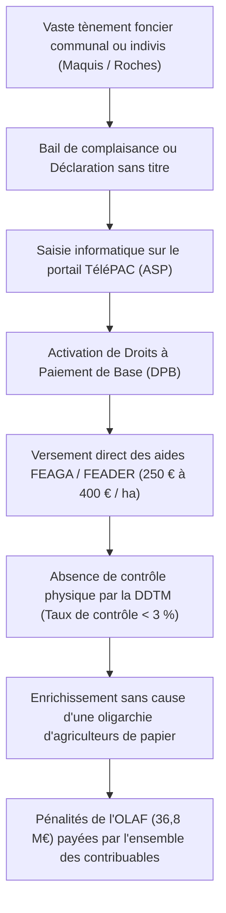

# RÉPUBLIQUE FRANÇAISE — TERRITOIRE DE CORSE
# ARCHIVES FORENSIQUES D'INSTRUCTION CITOYENNE — L'OCHJU
## DOSSIER D'INSTRUCTION FRAUDE AGRICOLE & PRIMES PAC — ENQUÊTE 20
### RÉFÉRENCE GREFFE : `LOCHJU-AUDIT-ENQUETE-20-PAC-OLAF-HECTARES-FICTIFS`

**Classification :** Renseignement Financier Européen, Audit Foncier & Munitions Pénales Opposables  
**Norme de Conservation :** ISO/IEC 27037 (Preuve Numérique Intègre)  
**Date d'arrêté des données et cotes :** Octobre 2026  
**Autorités & Sources Primaires :** Office Européen de Lutte Anti-Fraude (OLAF, Rapports d'enquête Bruxelles), Agence de Services et de Paiement (ASP), Direction Départementale des Territoires et de la Mer (DDTM 2A/2B), Cour d'Appel de Bastia (Arrêts Chambre Correctionnelle), ODARC  
**Destinataires :** Assemblée de Corse, Parquet Européen (EPPO), Jeunes Agriculteurs de Corse, Collectifs Pastoraux, Usagers et Contribuables  
**Devise :** *« Le Savoir partagé est notre contre-pouvoir. L'OCHJU, c'est le regard qui ne se détourne plus. »*

---

## FICHE SYNTHÉTIQUE DU SCANDALE DES PRIMES PAC EN CORSE

- **Enveloppe globale PAC allouée à la Corse :** ~ 38 Millions d'Euros par an (1er et 2nd piliers de la Politique Agricole Commune).
- **Sanction financière historique OLAF contre la France :** **36,8 Millions d'Euros de pénalités et refus d'apurement** infligés par la Commission Européenne pour défaillance généralisée des contrôles en Corse.
- **Taux de concentration des primes :** **10 % des bénéficiaires captent plus de 55,4 % de l'ensemble des aides PAC** insulaires.
- **Mécanisme central de la fraude :** La déclaration d'hectares pastoraux fictifs non clôturés et non pâturés (surfaces rocheuses inaccessibles, maquis impénétrable, crêtes sommitales à 1 800 mètres d'altitude déclarées comme « pâturages permanents »).
- **Le système des Droits à Paiement de Base (DPB) :** Déconnexion totale entre la possession réelle d'un cheptel vivant et la perception de la rente financière à l'hectare.
- **Bétail fantôme et absence d'identification :** Écart massif entre les déclarations administratives dans le logiciel TéléPAC et la présence effective d'animaux bagués et vaccinés sur le terrain.
- **Spoliation des jeunes éleveurs réels :** Flambée spéculative des baux ruraux, captation des terres communales par des éleveurs de papier, et impossibilité pour les jeunes exploitants insulaires de s'installer faute de droits fonciers disponibles.

---

## I. AUTOPSIE FORENSIQUE DU SYSTÈME DES « HECTARES DE PAPIER »

La fraude aux primes agricoles en Corse ne relève pas de la petite délinquance opportuniste : elle a été organisée comme une industrie financière d'accaparement de rente européenne avec la complaisance passive des services de contrôle de l'État.

### 1. La bascule perverse de la réforme PAC de 2015
Avant 2015, les aides directes européennes à l'élevage étaient en partie indexées sur le nombre de bêtes (primes à la vache allaitante, primes à la brebis). La réforme européenne de 2015 a imposé le découplage intégral et le basculement vers les **Droits à Paiement de Base (DPB)** calculés à la surface déclarée :
- Chaque hectare admissible génère une rente annuelle directe de **120 € à 280 €**, assortie du paiement vert et de l'Indemnité Compensatoire de Handicaps Naturels (ICHN pouvant atteindre 150 € / ha).
- Pour toucher un million d'euros d'aides européennes sur cinq ans, un exploitant n'a plus besoin d'élever des troupeaux, de fabriquer du fromage ou d'investir dans une bergerie moderne : **il lui suffit de déclarer des milliers d'hectares de maquis sur les relevés cadastraux de TéléPAC**.



### 2. Le scandale des terres communales et des forêts domaniales déclarées sans droit
Les rapports confidentiels de l'OLAF ont mis au jour un procédé saisissant :
- Des exploitants sans scrupules ont tracé des polygones de déclaration PAC englobant des parcelles appartenant à des communes de montagne, à des propriétaires indivis décédés depuis un siècle ou au domaine forestier de l'État, **sans disposer du moindre bail rural ni de la moindre convention de pâturage signée**.
- Les services de la DDTM de Haute-Corse et de Corse-du-Sud ont validé ces déclarations d'îlots de référence pendant des années sans exiger de titre d'occupation opposable.
- Lorsque de jeunes agriculteurs ont voulu s'installer pour créer de réels élevages de chèvres ou de porcs Nustrale, ils ont découvert que les terres de leur propre village étaient déjà « cadastrées » dans TéléPAC au bénéfice d'exploitants fantômes résidant à des dizaines de kilomètres de là.

---

## II. L'AUDIT DE LA DÉFAILLANCE ÉTATIQUE ET LES CONDAMNATIONS JUDICIAIRES

La responsabilité de l'administration préfectorale et de l'Agence de Services et de Paiement (ASP) a été formellement actée par les juridictions financières et pénales :

### 1. Le couperet de l'Office Européen de Lutte Anti-Fraude (OLAF)
À la suite d'une inspection sur place menée par les enquêteurs de l'OLAF en Corse, la Commission européenne a infligé à la France un **refus d'apurement financier de 36,8 millions d'euros**. Bruxelles a expressément fustigé :
- L'absence de vérification sur le terrain du caractère effectivement pâturable des surfaces déclarées (présence d'arbustes denses non pâturés par les bovins).
- L'inadéquation flagrante du Registre Parcellaire Graphique (RPG) français avec la réalité topographique insulaire.
- La complaisance politique locale ayant conduit l'État à ne pas recouvrer les sommes indûment perçues pour éviter des tensions syndicales.

### 2. Les condamnations pénales prononcées par la Cour d'appel de Bastia
Devant l'ampleur du scandale, la justice pénale a dû intervenir. Dans plusieurs arrêts retentissants rendus entre 2021 et 2025 par la Chambre Correctionnelle de la Cour d'appel de Bastia :
- De faux éleveurs et des cadres de structures agricoles ont été lourdement condamnés pour **escroquerie en bande organisée aux fonds publics européens**, faux et usage de faux, et blanchiment.
- Des peines de prison ferme, des confiscations d'avoirs criminels portant sur des millions d'euros (villas sur le littoral, comptes bancaires bloqués) et des interdictions définitives d'exercer toute activité agricole ont été prononcées.
- Les juges ont relevé l'existence de cheptels bovins sauvages non vaccinés, laissés à l'abandon sur les routes et dans les villages sans aucun suivi sanitaire, créant un danger mortel pour les automobilistes et la prolifération de la tuberculose bovine.

---

## III. LE PLAN DE SALUT PASTORAL : LE CADASTRE BIOMÉTRIQUE SOUVERAIN

Pour éradiquer définitivement la captation des primes et restituer les terres aux éleveurs réels qui nourrissent la population, L'OCHJU propose le déploiement du **Cadastre Pastoral Souverain de Corse** articulé en trois armes techniques inviolables :

### 1. Le Bolus RFID stomacal obligatoire
Chaque animal éligible aux aides pastorales en Corse doit être équipé d'un **bolus électronique intraruminal (puce RFID insérée dans le rumen)** infalsifiable et géolocalisable, rendant impossible la fraude classique consistant à s'échanger des boucles auriculaires en plastique d'un troupeau à l'autre lors des contrôles.

### 2. Le contrôle satellite automatique Copernicus & LiDAR
Croisement mensuel automatique des déclarations de parcelles TéléPAC avec l'imagerie satellite radar Sentinel-1 et optique Sentinel-2 de l'Agence Spatiale Européenne :
- Calcul de l'indice de biomasse réellement consommée par le cheptel.
- Exclusion algorithmique instantanée des zones de maquis fermé, des falaises rocheuses et des pentes > 45 % non pâturables.

### 3. La Régie Territoriale des Droits à Paiement (ODARC)
La Collectivité de Corse doit obtenir par loi organique la maîtrise exclusive de l'attribution des DPB sur son territoire. Les droits d'aide ne doivent plus être la propriété spéculative d'individus, mais être rattachés au sol nourricier et attribués en priorité aux jeunes exploitants engagés dans la transformation fromagère et bouchère locale sous AOP.

---

## IV. BORDEREAU DES PIÈCES SCELLÉES & RÉQUISITIONS CITOYENNES

En vertu du droit d'accès aux actes administratifs (Art. L. 311-1 CRPA), les citoyens et collectifs d'agriculteurs ont le pouvoir d'exiger :

1. **Pièce PAC-01 :** Les rapports d'audit complets de l'OLAF (Direction Enquêtes II, Bruxelles) relatifs au refus d'apurement financier de 36,8 M€ infligé à la France au titre des aides agricoles en Corse.
2. **Pièce PAC-02 :** La liste exhaustive anonymisée mais géoréférencée par commune des surfaces pastorales déclarées au titre du Registre Parcellaire Graphique (RPG) auprès de la DDTM de Corse-du-Sud et de Haute-Corse.
3. **Pièce PAC-03 :** L'état des ordres de reversement et des pénalités effectivement recouvrés par l'Agence de Services et de Paiement (ASP) à l'encontre des bénéficiaires condamnés pour fraude aux DPB.
4. **Pièce PAC-04 :** Les procès-verbaux de contrôle sanitaire vétérinaire de la DDCSPP constatant l'état des cheptels errants et la traçabilité des boucles auriculaires dans les communes de l'intérieur.

---

## V. MODÈLE DE RECOURS CITOYEN POUR CONTESTATION DES BAUX FICTIFS

```text
MODÈLE DE SIGNALEMENT AU PROCUREUR DE LA RÉPUBLIQUE ET AU PARQUET EUROPÉEN (EPPO)
Article 40 du Code de Procédure Pénale

À l'attention de Monsieur le Procureur de la République près le Tribunal Judiciaire de [Bastia / Ajaccio]
Et de Madame / Monsieur le Procureur Européen Délégué (EPPO)

Les soussignés, éleveurs et citoyens de la commune de [...], ont l'honneur de porter à votre connaissance 
les faits pénalement répréhensibles suivants :

Sur les parcelles communales cadastrées Section [...] n° [...], d'une superficie globale de [...] hectares, 
classées en maquis dense et crêtes inaccessibles ;
Il a été constaté qu'une déclaration d'admissibilité au titre des aides du FEAGA a été souscrite par le sieur [...] 
au titre de la campagne TéléPAC 2024-2026 pour un montant estimé à [...] euros d'aides directes ;
Or, les constatations matérielles attestent qu'aucun cheptel vivant n'a jamais pâti sur lesdites parcelles, 
que le déclarant ne dispose d'aucun bail communal légalement délivré par délibération du Conseil Municipal, 
et que la végétation ne présente aucune trace de dépaissance ;

Ces agissements sont constitutifs des délits d'escroquerie aggravée aux fonds publics européens (Art. 313-1 et 313-2 du Code Pénal), 
de faux et usage de faux (Art. 441-1), et de prise illégale d'intérêts ;

PAR CES MOTIFS :
Nous vous prions de bien vouloir ouvrir une enquête préliminaire, d'ordonner la saisie conservatoire 
des versements de l'Agence de Services et de Paiement (ASP), et d'engager les poursuites pénales appropriées.
```

---

> *« Le Savoir partagé est notre contre-pouvoir. L'OCHJU, c'est le regard qui ne se détourne plus. — Cellule d'Investigation L'OCHJU »*
