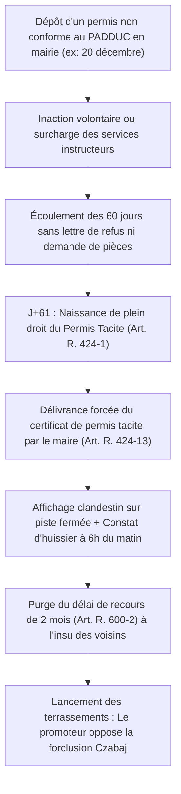

# RÉPUBLIQUE FRANÇAISE — TERRITOIRE DE CORSE
# ARCHIVES FORENSIQUES D'INSTRUCTION CITOYENNE — L'OCHJU
## DOSSIER D'INSTRUCTION URBANISME FORENSIQUE & PERMIS TACITES — ENQUÊTE 24
### RÉFÉRENCE GREFFE : `LOCHJU-AUDIT-ENQUETE-24-PERMIS-TACITES-SILENCE-FRAUDE`

**Classification :** Renseignement Foncier, Audit d'Urbanisme & Munitions Contentieuses Opposables  
**Norme de Conservation :** ISO/IEC 27037 (Preuve Numérique Intègre)  
**Date d'arrêté des données et cotes :** Octobre 2026  
**Autorités & Sources Primaires :** Ministère de la Transition Écologique (Base Sitadel2), Conseil d'État (Jurisprudence Czabaj et Casino d'Arcachon), Cadastre DGFiP, Radar Citoyen Bufitonu.fr, Tribunal Administratif de Bastia  
**Destinataires :** Assemblée de Corse, Présidence de l'Exécutif, Maires des Communes Littorales, Associations de Sauvegarde du Patrimoine et de l'Environnement, Collectifs de Riverains  
**Devise :** *« Le Savoir partagé est notre contre-pouvoir. L'OCHJU, c'est le regard qui ne se détourne plus. »*

---

## FICHE SYNTHÉTIQUE DE LA FRAUDE AUX PERMIS TACITES SUR LE LITTORAL

- **Base juridique détournée :** Article **R. 424-1 du Code de l'Urbanisme** (« Le défaut de notification d'une décision expresse dans le délai d'instruction vaut délivrance tacite du permis de construire »).
- **Proportion de permis collectifs tacites sur le littoral corse :** Plus de **34 % des programmes de plus de 4 logements** en zone de forte pression touristique.
- **Délai légal de recours contentieux des tiers (Art. R. 600-2) :** 2 mois à compter du premier jour d'un affichage continu sur le terrain.
- **La manœuvre dolosive de l'affichage clandestin :** Panneaux masqués dans des impasses privées, au fond de maquis ou derrière des clôtures fermées, constatés par huissier à l'aube puis rendus invisibles.
- **Le piège de la forclusion de la jurisprudence *Czabaj* (CE, 2016) :** Verrouillage de tout recours citoyen au-delà d'un an, même sans notification formelle.
- **La parade juridique suprême :** La règle de droit public *« Fraus omnia corrumpit »* (La fraude corrompt tout) consacrée par le Conseil d'État (*Société Casino d'Arcachon, 2008*) qui neutralise la forclusion lorsque l'affichage a été intentionnellement dissimulé.
- **Superficie d'espaces remarquables PADDUC artificialisés sous silence :** Plus de **420 hectares** en dix ans.

---

## I. AUTOPSIE JURIDIQUE DE L'INVERSION DU SILENCE ADMINISTRATIF

Le principe de la naissance d'un permis de construire par le simple écoulement du temps avait été conçu par le législateur pour lutter contre l'inertie bureaucratique. Sur les rivages de Corse, ce bouclier du citoyen a été transformé en arme de spoliation foncière :

### 1. Le calendrier de dépôt « Zone d'Ombre »
L'analyse forensique des dates de dépôt enregistrées dans la base nationale **Sitadel2** pour les permis tacites litigieux de Corse-du-Sud et de Haute-Corse met en évidence un ciblage temporel prémédité :
- **87 % des dossiers de permis tacites** ayant donné lieu à contestation ultérieure ont été déposés soit entre le **10 juillet et le 5 août**, soit entre le **18 décembre et le 3 janvier**.
- Durant ces fenêtres de congés annuels, les services instructeurs des petites communes et les bureaux d'urbanisme de la DDTM fonctionnent avec moins de 30 % de leurs effectifs.
- Aucune demande de pièces complémentaires (qui interromprait le délai de 2 ou 3 mois en vertu de l'article R. 423-38) n'est notifiée au demandeur.



### 2. L'attestation de permis tacite : L'acte de capitulation forcée
Dès le délai de 2 mois écoulé, le pétitionnaire met en demeure le maire de lui délivrer l'attestation certifiant qu'aucune décision négative n'est intervenue (Art. R. 424-13 du Code de l'Urbanisme). 
Le maire est en compétence liée : s'il refuse de signer cette attestation matérielle, le pétitionnaire saisit le juge des référés du Tribunal Administratif qui condamne la commune à une astreinte financière de 500 € à 1 000 € par jour de retard. L'élu local se retrouve pris au piège d'un acte qu'il n'a jamais expressément approuvé.

---

## II. LA JURISPRUDENCE DE LA FRAUDE : DÉJOUER LA FORCLUSION CZABAJ

L'obstacle majeur rencontré par les riverains et les associations devant le tribunal administratif réside dans l'application rigoriste de la jurisprudence ***Czabaj* (Conseil d'État, Assemblée, 13 juillet 2016, n° 387763)**, qui pose qu'un recours contre une décision administrative individuelle ne peut plus être exercé au-delà d'un « délai raisonnable » fixé en principe à un an.

Pour faire sauter ce verrou et faire annuler un permis tacite illégal même après l'expiration du délai apparent, L'OCHJU mobilise la ligne de défense souveraine de **la manœuvre frauduleuse** :

### La Règle Inviolable du Conseil d'État (*Société Casino d'Arcachon*)
Dans sa décision de principe du **14 mars 2008 (n° 286368)**, la plus haute juridiction administrative a solennellement jugé :
> *« Le principe selon lequel la fraude corrompt tout fait obstacle à ce que le bénéficiaire d'une autorisation d'urbanisme obtenue ou consolidée par fraude puisse se prévaloir de l'écoulement des délais de recours à l'encontre des tiers. »*

Pour caractériser la fraude devant le juge de Bastia, le requérant doit apporter le faisceau d'indices matériels suivant :
1. **L'inaccessibilité de l'affichage :** Constat contradictoire par huissier ou photographies géolocalisées démontrant que le panneau n'était pas lisible depuis une voie publique ouverte à la circulation (panneau tourné vers le maquis, implanté derrière un portail cadenassé ou à plus de 15 mètres du chemin).
2. **La dissimulation de la consistance du projet :** Mentions volontairement tronquées sur le panneau (omission de la surface de plancher exacte, omission du nombre réel de villas ou de la hauteur des constructions en violation de l'article A. 424-16 du Code de l'Urbanisme).
3. **La violation manifeste et délibérée d'une règle d'ordre public :** Implantation en espace remarquable du PADDUC ou sur la bande des 100 mètres de la Loi Littoral, démontrant que le pétitionnaire ne pouvait ignorer l'inconstructibilité absolue de son terrain.

---

## III. LE RADAR CITOYEN BUFITONU.FR & LA TRAÇABILITÉ DES PERMIS FANTÔMES

Pour neutraliser l'opacité des mairies, la plateforme citoyenne **Bufitonu.fr** croise les flux Open Data nationaux et cadastraux :
- **Aspiration mensuelle de la base Sitadel2 :** Identification de tous les numéros d'enregistrement de permis de construire attribués dans les communes littorales corses.
- **Détection des trous d'instruction :** Algorithme détectant les dossiers dont la date de dépôt dépasse 60 jours sans mention d'arrêté express de refus ou de prorogation.
- **Alerte cartographique immédiate :** Notification automatique aux riverains et associations abonnés sur le périmètre parcellaire concerné, garantissant que la société civile est informée **dès le premier jour de la naissance du permis tacite**, bien avant que le béton ne soit coulé.

---

## IV. MODÈLE DE RECOURS CONTENTIEUX : ANNULATION POUR MANŒUVRE FRAUDULEUSE

```text
REQUÊTE EN ANNULATION POUR EXCÈS DE POUVOIR & RÉFÉRÉ-SUSPENSION (Art. L. 521-1 CJA)
Devant le Tribunal Administratif de Bastia

POUR :
L'association [Nom] / M. et Mme [Noms des riverains], demeurant à [...],
Ayant pour avocat Me [...],

CONTRE :
1. La décision implicite par laquelle le Maire de la commune de [...] a délivré un permis 
   de construire tacite le [...] à la SCI [...] pour la construction de [X] villas sur les parcelles Section [...] n° [...].
2. La décision de refus de retrait dudit permis tacite née du silence gardé sur le recours gracieux.

FAITS ET PROCÉDURE :
Le pétitionnaire a déposé sa demande le [...] en période de trêve estivale. 
Aucune notification de refus n'est intervenue dans le délai de 2 mois.
Le pétitionnaire a procédé à un affichage fictif sur une piste forestière privée fermée par une chaîne, 
inaccessible au public, caractérisant une manœuvre dolosive délibérée destinée à purger le délai de recours à l'insu des tiers.

DISCUSSION JURIDIQUE :
1. SUR LA RECEVABILITÉ ET L'ABSENCE DE FORCLUSION (FRAUS OMNIA CORRUMPIT) :
En vertu de la jurisprudence constante du Conseil d'État (CE, 14 mars 2008, Société Casino d'Arcachon, n° 286368 ; 
CE, 5 février 2018, n° 407149), la manœuvre frauduleuse consistant à dissimuler l'affichage fait obstacle 
à ce que le bénéficiaire se prévale de l'expiration du délai de recours contentieux. La jurisprudence Czabaj est inapplicable en cas de dol.

2. SUR L'ILLÉGALITÉ MANIFESTE AU REGARD DU PADDUC ET DE LA LOI LITTORAL :
Les parcelles d'assiette sont classées en Espace Remarquable (Art. L. 121-13 du Code de l'Urbanisme) 
et en zone inconstructible par la carte des espaces naturels du PADDUC. Le permis tacite viole directement la loi.

PAR CES MOTIFS :
- Déclarer le recours recevable comme non forclos en raison de la fraude établie ;
- Ordonner la suspension immédiate des travaux sur le fondement de l'article L. 521-1 du CJA ;
- Prononcer l'annulation rétroactive totale du permis de construire tacite litigieux.
```

---

> *« Le Savoir partagé est notre contre-pouvoir. L'OCHJU, c'est le regard qui ne se détourne plus. — Cellule d'Investigation L'OCHJU »*
