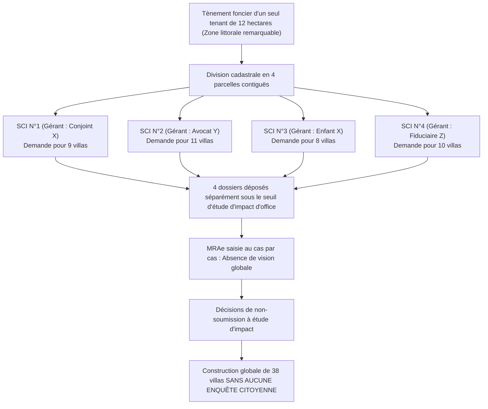

# RÉPUBLIQUE FRANÇAISE — TERRITOIRE DE CORSE
# ARCHIVES FORENSIQUES D'INSTRUCTION CITOYENNE — L'OCHJU
## DOSSIER D'INSTRUCTION TRANSPARENCE DES AMÉNAGEURS & SAUCILLONNAGE MRAE — ENQUÊTE 25
### RÉFÉRENCE GREFFE : `LOCHJU-AUDIT-ENQUETE-25-SAUCILLONNAGE-MRAE-RBE-INPI`

**Classification :** Renseignement Financier et Environnemental, Audit Sociétaire & Munitions Contentieuses  
**Norme de Conservation :** ISO/IEC 27037 (Preuve Numérique Intègre)  
**Date d'arrêté des données et cotes :** Octobre 2026  
**Autorités & Sources Primaires :** Mission Régionale d'Autorité Environnementale (MRAe Corse), Registre National des Entreprises (INPI RBE), Code de l'Environnement (Arts. L. 122-1 et R. 122-2), Conseil d'État, DREAL Corse  
**Destinataires :** Assemblée de Corse, Conseil d'État, Parquet National Financier (PNF), Associations Écologistes Agréées, Citoyens  
**Devise :** *« Le Savoir partagé est notre contre-pouvoir. L'OCHJU, c'est le regard qui ne se détourne plus. »*

---

## FICHE SYNTHÉTIQUE DE LA FRAUDE AU FRACTIONNEMENT DE DOMAINES FONCIERS

- **Base légale détournée :** Tableau annexé à l'article **R. 122-2 du Code de l'Environnement** (Rubrique 39 : Projets d'aménagement et lotissements soumis à étude d'impact ou cas par cas selon les seuils d'emprise au sol et de surface de plancher).
- **Technique opératoire du « saucillonnage » :** Division artificielle d'un grand domaine de 10 à 25 hectares en 4 à 6 lots juridiquement distincts confiés à des Sociétés Civiles Immobilières (SCI) sœurs.
- **Taux de fractionnement constaté sur le littoral :** Plus de **42 % des lotissements de plus de 15 villas** ont fait l'objet de demandes fractionnées pour échapper à l'évaluation environnementale lourde.
- **Dissimulation des maîtres d'ouvrage réels :** Utilisation de gérants de paille ou d'hommes de confiance locaux masquant les holdings de contrôle immatriculées au Luxembourg, en Suisse ou en Irlande.
- **L'arme de contre-attaque :** Le **Registre des Bénéficiaires Effectifs (RBE)** de l'INPI qui permet de prouver l'unité de contrôle capitalistique (> 25 % du capital ou des droits de vote).
- **Conséquence écologique directe :** Destruction irréversible de zones humides, coupure de corridors biologiques et écrasement de populations de la **Tortue d'Hermann (*Testudo hermanni*)** sans aucune compensation écologique (séquence ERC ignorée).

---

## I. LE MÉCANISME DU SAUCILLONNAGE : COMMENT ÉLUDER L'ENQUÊTE PUBLIQUE

En vertu du droit européen (Directive 2011/92/UE modifiée) et de l'article L. 122-1 du Code de l'Environnement, les citoyens disposent d'un droit fondamental à participer à l'évaluation des projets ayant un impact notable sur leur cadre de vie par le biais de l'**enquête publique de 30 jours**.

Pour priver la population de ce droit et éviter de financer des inventaires naturalistes sur quatre saisons (coût : 40 000 € à 90 000 € par étude complète), les aménageurs appliquent une ingénierie de découpage méthodique :



Dans ce schéma, chaque tranche prise individuellement apparaît bénigne aux yeux de l'instructeur de la DREAL. Mais sur le terrain, c'est l'ensemble du massif boisé qui est défriché, terrassé et imperméabilisé, avec des voiries communes et des réseaux d'égouts partagés qui démontrent matériellement **l'unicité de l'opération d'aménagement**.

---

## II. L'ARME ABSOLUE DU REGISTRE DES BÉNÉFICIAIRES EFFECTIFS (RBE)

Pour apporter au juge administratif la preuve irréfutable de la fraude, L'OCHJU mobilise l'article **L. 561-46 du Code Monétaire et Financier** et les données certifiées du Registre National des Entreprises (INPI).

La réglementation oblige chaque société commerciale ou civile immatriculée en France à déclarer l'identité des personnes physiques qui la contrôlent en dernier ressort (les bénéficiaires effectifs détenant plus de 25 % du capital ou exerçant un pouvoir de contrôle sur les organes de direction).

### Exemple d'Instruction Forensique Type
L'analyse croisée des métadonnées du greffe et du RBE permet de dresser le tableau d'imputation suivant :

| Société Pétitionnaire | Gérant en Titre | Détenteur des Parts à 99 % | Bénéficiaire Effectif Réel (RBE) | Domicile Fiscal Ultime |
| :--- | :--- | :--- | :--- | :--- |
| **SCI A** (9 villas) | M. Pierre F. (Prête-nom local) | Holding SOPARFI X (Luxembourg) | **M. Bernard V.** | Genève (Suisse) |
| **SCI B** (11 villas) | Mme Sophie G. (Assistante juridique) | Holding SOPARFI X (Luxembourg) | **M. Bernard V.** | Genève (Suisse) |
| **SCI C** (8 villas) | Cabinet fiduciaire Fiducor | Holding SOPARFI X (Luxembourg) | **M. Bernard V.** | Genève (Suisse) |

**Le constat médico-légal est imparable : derrière trois personnes morales apparemment distinctes se cache un seul et même centre d'intérêt économique et financier.**

---

## III. LA JURISPRUDENCE CONSTANTE DU CONSEIL D'ÉTAT CONTRE LE FRACTIONNEMENT

Le juge administratif sanctionne avec une fermeté constante cette technique d'évitement. 

Dans un arrêt majeur du **19 juillet 2017 (n° 394983)**, le Conseil d'État a rappelé les critères cumulatifs interdisant la disjonction de projets :
1. **La proximité géographique immédiate :** Des parcelles issues du même tènement d'origine ou contiguës.
2. **La continuité fonctionnelle et matérielle :** L'utilisation d'une voie d'accès partagée, d'un même poste de transformation Enedis ou d'un raccordement commun au réseau d'assainissement collectif.
3. **La communauté d'intérêts des pétitionnaires :** L'identité des actionnaires ultimes ou l'existence de conventions de maîtrise d'ouvrage déléguée croisées.

Lorsque ces trois éléments sont réunis, l'opération doit obligatoirement être appréciée **dans sa globalité**. Le fait d'avoir saucillonné les demandes entache l'ensemble des autorisations d'un **vice de procédure substantiel** qui justifie leur annulation rétroactive totale.

---

## IV. BORDEREAU DES PIÈCES SCELLÉES & RÉQUISITIONS CITOYENNES

1. **Pièce MRAE-01 :** Les décisions de dispense d'étude d'impact au cas par cas rendues par la MRAe Corse sur les parcelles cadastrées Section [...] n° [...].
2. **Pièce MRAE-02 :** Les extraits certifiés Kbis et fiches RBE de l'INPI établissant l'organigramme capitalistique complet des SCI requérantes.
3. **Pièce MRAE-03 :** Le plan de masse global consolidé démontrant la mitoyenneté des parcelles, la continuité des voiries et le caractère indivisible du programme immobilier.
4. **Pièce MRAE-04 :** L'inventaire naturaliste indépendant attestant de la présence d'espèces protégées (Tortue d'Hermann) sur l'emprise globale du massif détruit.

---

## V. MODÈLE DE RECOURS : FRACTIONNEMENT FRAUDULEUX DEVANT LE TRIBUNAL ADMINISTRATIF

```text
MÉMOIRE EN ANNULATION POUR FRACTIONNEMENT ILLÉGAL D'UN PROJET D'AMÉNAGEMENT
Devant le Tribunal Administratif de Bastia

POUR :
Le collectif citoyen / L'association de protection de l'environnement [Nom],

CONTRE :
Les arrêtés n° [...] portant permis de construire délivrés par le Maire de [Commune] aux SCI [Noms],

FAITS ET ÉLÉMENTS DE FRAUDE :
Les permis attaqués autorisent la réalisation globale de [...] logements sur un massif naturel de [...] hectares.
Les pétitionnaires ont scindé artificiellement leur demande entre [X] SCI distinctes créées à quelques semaines d'intervalle.
L'examen du Registre des Bénéficiaires Effectifs (INPI) démontre que l'ensemble du capital de ces sociétés 
est contrôlé par la même entité financière [Nom], caractérisant une manœuvre dolosive de contournement des seuils.

DROIT APPLICABLE :
En application de l'article L. 122-1 du Code de l'Environnement et de la jurisprudence constante du Conseil d'État 
(CE, 19 juillet 2017, n° 394983 ; CE, 13 mars 2019, n° 414930), l'impact environnemental d'un programme de travaux 
doit être apprécié de façon globale dès lors que les tranches présentent une connexité géographique, matérielle et financière.
La disjonction frauduleuse a privé le public de l'étude d'impact complète et de l'enquête publique légale, 
ce qui constitue un vice de procédure substantiel au sens de la jurisprudence Danthony (CE, Ass., 23 décembre 2011).

PAR CES MOTIFS :
- Juger que les permis de construire délivrés procèdent d'un fractionnement illégal d'opération d'ensemble ;
- Prononcer l'annulation rétroactive totale des permis de construire délivrés auxdites SCI.
```

---

> *« Le Savoir partagé est notre contre-pouvoir. L'OCHJU, c'est le regard qui ne se détourne plus. — Cellule d'Investigation L'OCHJU »*
