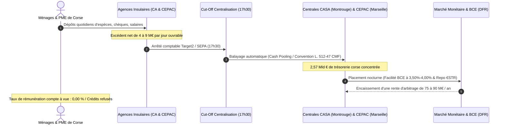

<!-- ==========================================================================
     CARTOUCHE POPULAIRE & FORENSIQUE : LE DOUBLE ÉTAGÈRE
     ========================================================================== -->

  

  <!-- ÉTAGÈRE CITOYENNE POPULAIRE (HAUT DE CARTOUCHE) -->
  

    

      
      
        👁️ U SAPÈ CITADINU : L'ÉQUATION CLINIQUE DU SIPHONNAGE BANCAIRE
      
    

    

      

        Dépôts Bancaires en Corse
        6,42 Mld €
        Banque de France Webstat CFTDC
      

      

        Prêts Réels aux Résidents
        3,85 Mld €
        Écart de 2,57 Mld € non réinjecté
      

      

        Ratio de Transformation
        59,97 %
        vs 102 % au niveau national
      

      

        Rente d'Arbitrage Évadée
        > 80 M€ / an
        Placements monétaires parisiens
      

    

    

      <strong>En clair pour votre foyer :</strong> Pour 100 € déposés sur un compte bancaire en Corse, 40 € quittent immédiatement l'île chaque soir pour être placés sur les marchés financiers parisiens et européens. Pendant ce temps, les jeunes ménages corses et les artisans subissent des refus de crédit records sous prétexte de « risque territorial ».
    

  

  <!-- ÉTAGÈRE FORENSIQUE LÉGALE (BAS DE CARTOUCHE) -->
  

    

      
      
        ⚖️ CADRE DE CONTRÔLE ET REMÈDES JURIDIQUES OPPOSABLES
      
    

    

      

        1. Menace Absolue : Fusion CA Corse / PCA
        Rapport 1 à 13. Perte du dernier siège bancaire insulaire. 120 emplois menacés. Motion CESECC n° 2026-05 & vote unanime Assemblée de Corse.
      

      

        2. Riposte : Fonds Souverain FSIDE
        Création d'un Community Reinvestment Act corse (taux plancher de 75 %) + « U Livretu Corsu » sanctuarisant 2,57 Mld € pour le logement et l'agriculture.
      

    

  

## I. L'Illusion de l'Île Assistée : La Réalité Chiffrée de la Sur-Liquidité Insulaire

Un mythe économique persistant dépeint la Corse comme une terre sous perfusion financière, dépendante de transferts publics continentaux pour subvenir à ses besoins monétaires.

L'analyse médico-légale des bilans bancaires pulvérise cette narration.

L'extraction des séries statistiques Webstat CFTDC (*Centralisation Financière Territoriale des Dépôts et Crédits*) de la Banque de France révèle que les résidents corses détiennent **6,42 milliards d'euros** d'avoirs bancaires bilanciels.

Ce matelas se décompose en :
* **2,645 milliards d'euros** en comptes de dépôts à vue (liquidités courantes rémunérées à **0,00 %**).
* **2,255 milliards d'euros** sur livrets d'épargne réglementée (Livret A, LDDS, LEP).
* **1,520 milliard d'euros** en épargne contractuelle et comptes à terme (PEL, CEL, CAT).

Si l'on adjoint les contrats d'assurance-vie et OPCVM gérés hors-bilan par Predica (Crédit Agricole) et Natixis/CNP (CEPAC), l'épargne financière brute des Corses excède **11,5 milliards d'euros**.

Rapportée au revenu disponible brut des ménages, la propension à l'épargne liquide en Corse figure parmi les plus fortes d'Europe occidentale. Cette sur-épargne constitue une réponse rationnelle à la précarité de l'économie saisonnière, à la faiblesse structurelle des salaires locaux et à l'absence de protection contre les chocs de coût de transport insulaire.

---

## II. Le Ratio de Transformation : 2,57 Milliards d'Euros Ponctionnés Hors de l'Économie Réelle

Le ratio de transformation (Loan-to-Deposit Ratio - LTD) met en regard les crédits accordés localement avec les dépôts collectés.

Sur le continent, les banques affichent un ratio moyen de **102 %**. Elles prêtent l'équivalent de la totalité des dépôts de leurs clients et font appel aux marchés financiers pour apporter des capitaux additionnels aux entreprises régionales.

En Corse, le système opère à front renversé :
* **Dépôts bancaires collectés :** 6,42 milliards d'euros.
* **Crédits réels alloués aux résidents insulaires :** 3,85 milliards d'euros.
* **Déduction forensique :** Déduction rigoureuse de 630 M€ de crédits immobiliers captés par des promoteurs continentaux et des SCI non-résidentes pour des villas de villégiature sur le littoral.

$$\\text{Ratio de Transformation Réel} = \\frac{3\\,850\\,000\\,000\\text{ €}}{6\\,420\\,000\\,000\\text{ €}} = \\mathbf{59,97\\ \\%}$$

Le déficit de financement s'établit à :

$$\\Delta_{\\text{fuite}} = 6\\,420\\,000\\,000\\text{ €} - 3\\,850\\,000\\,000\\text{ €} = \\mathbf{2\\,570\\,000\\,000\\text{ €}}$$

La Corse subit un drainage net de **2,57 milliards d'euros**. Ce capital manquant représente plus du quart du PIB territorial.

Pendant que ces milliards sont déportés, le tissu économique insulaire étouffe :
1. **38 % des demandes d'investissement des TPE/PME corses sont rejetées** par les comités de crédit bancaires.
2. **84 % des entrepreneurs** se voient imposer une caution solidaire sur leurs biens personnels pour obtenir un prêt d'exploitation.
3. **35 % des agences bancaires de l'intérieur rural ont été fermées** en quinze ans, abandonnant les personnes âgées et commerçants des villages sans distributeur de billets ni conseil de proximité.

---

## III. Le Circuit Quotidien du Cash Pooling : Comment l'Épargne Quitte l'Île Chaque Soir

L'argent déposé à Bastia, Ajaccio, Ghisonaccia ou Sartène ne reste pas dans les coffres de l'île.

### La mécanique en cinq temps :
1. **17h30 : Arrêté de compensation.** Clôture des flux SEPA. Les comptes miroirs des agences enregistrent les excédents journaliers.
2. **18h30 : Déclenchement du sweeping.** En application de conventions de trésorerie centralisée :
   - Pour le Crédit Agricole de la Corse, la position créditrice remonte sur le compte de centralisation de **Crédit Agricole S.A. (CASA)** à Montrouge (Art. L. 512-47 du CMF).
   - Pour la Caisse d'Épargne CEPAC, succursale pure, les liquidités sont absorbées par le siège de Marseille (Place Estrangin) et consolidées chez **BPCE / Natixis** à Paris.
3. **20h00 : Déploiement monétaire.** Les états-majors continentaux prêtent ces liquidités :
   - À la **Banque Centrale Européenne** via la facilité de dépôt rémunérée au taux de 3,50 % à 4,00 %.
   - Sur le **marché interbancaire (€STR)** sous forme de pensions livrées (*Repo*) finançant les banques internationales.
4. **Captation de la rente de spread :**  
   Les dépôts à vue corses coûtent **0,00 %** aux banques. Les placements monétaires rapportent plus de 3,50 %.  
   Sur 2,57 milliards d'euros, ce différentiel génère **plus de 80 millions d'euros par an** de marge nette sans risque. Ces profits s'évaporent au profit des sièges parisiens.

---

## IV. L'Offensive PCA : Le Projet d'Absorption Déguisée du Crédit Agricole de la Corse

En septembre 2026, la Direction Générale du Crédit Agricole de la Corse a dévoilé son projet de rapprochement avec la Caisse Régionale Provence Côte d'Azur (PCA).

### Le prétexte officiel désamorcé (Prebunking)
La direction invoque les contraintes prudentielles de Bâle IV et les coûts informatiques.  
Ces arguments ne résistent pas à l'épreuve des comptes certifiés du CRCAM Corse au 31 décembre 2025 :
* **Solvabilité :** Ratio de fonds propres CET1 supérieur à **18,5 %** (le seuil réglementaire est de 10,5 %).
* **Rentabilité :** Produit Net Bancaire de **112,6 M€** et bénéfice net de **23,4 M€**.
* **Solidité :** Bilan de **4,31 milliards d'euros** en progression constante.

La banque insulaire ne présente aucune vulnérabilité financière. Il s'agit d'une opération de centralisation bureaucratique au détriment des sociétaires corses.

### La disproportion absolue des forces
Le Crédit Agricole Provence Côte d'Azur pèse **55 milliards d'euros de bilan**, compte 1,1 million de clients et 3 800 salariés.

Le rapport de force est de **1 contre 13**.

Dans cette structure fusionnée, la Corse ne possèdera qu'une part résiduelle de **7 % des droits de vote** au Conseil d'Administration. Elle n'aura aucun pouvoir de blocage.

### Les conséquences concrètes :
* **Disparition de la dernière banque autonome :** Le siège d'Ajaccio sera déclassé en simple antenne administrative.
* **Délocalisation des comités d'octroi de crédit :** Les financements supérieurs à 500 000 € seront arbitrés à Nice ou Draguignan par des grilles de scoring quantitatives aveugles aux réalités locales.
* **Casse sociale :** Menace directe sur **120 à 150 postes de siège qualifiés** à Ajaccio (RH, juridique, comptabilité, contentieux), voués à être rayés de la carte au nom des « synergies de réseau ».
* **Dépouillement des 2,57 milliards d'épargne :** L'excédent de liquidités corses servira directement à refinancer la promotion immobilière de la Côte d'Azur.

### Le front du refus unanime
* **16 septembre 2026 :** Grève générale à 100 % des 430 salariés à l'appel de l'intersyndicale SNECA-CGT et STC. Les 30 agences de l'île restent fermées.
* **25 septembre 2026 :** Motion n° 2026-05 du CESECC réclamant l'abandon sans condition du projet d'absorption.
* **1er et 2 octobre 2026 :** Vote unanime de l'Assemblée de Corse condamnant toute perte d'autonomie bancaire.

---

## V. L'Alternative Souveraine : Le Fonds Souverain Insulaire (FSIDE) et « U Livretu Corsu »

Pour sortir du piège de la captation, L'OCHJU pose les fondations institutionnelles du **Fonds Souverain Insulaire de Développement et d'Épargne (FSIDE)** (*Cassa di Sviluppu è d'Accunciamentu di a Corsica*).

### 1. Le Community Reinvestment Act (CRA) Insulaire
Transposition en droit territorial de la législation américaine de 1977 :
* **Obligation de réinjection minimale de 75 % :** Toute banque opérant en Corse doit maintenir un ratio prêts/dépôts locaux d'au moins 75 %.
* **Taxe Territoriale de Fuite de Trésorerie (1,50 %) :** Pénalité financière prélevée sur chaque euro d'épargne corse exporté sur les marchés extérieurs excédant le seuil de tolérance prudentielle.
* **Dispositif d'exonération :** La banque peut déposer ses surplus de trésorerie au FSIDE, qui les injecte dans les priorités insulaires.

### 2. Le Produit d'Épargne Populaire : « U Livretu Corsu »
* Plafonné à 30 000 € par résident fiscal insulaire.
* Garanti par la Collectivité de Corse et la Caisse des Dépôts.
* Taux Livret A bonifié de **+0,50 %** net d'impôt.
* Sanctuarisation légale : 100 % des fonds restent sur le territoire insulaire.

### 3. Allocation des 2,57 Milliards d'Euros Rapatriés

| Pôle Stratégique | Volume Alloué | Destinations Précises |
| :--- | :--- | :--- |
| **Logement Résidentiel (40 %)** | **1 028 000 000 €** | Prêts à taux zéro primo-accédants résidents, Baux Réels Solidaires, réhabilitation du bâti ancien villageois |
| **Économie & Paysannerie (30 %)** | **771 000 000 €** | Prêts de campagne à 1 % pour les éleveurs/agriculteurs, quasi-fonds propres pour l'artisanat et la pêche |
| **Transition Écologique (20 %)** | **514 000 000 €** | Régies publiques de l'eau, micro-hydroélectricité villageoise, centres de valorisation des déchets |
| **Réserve Prudentielle (10 %)** | **257 000 000 €** | Matelas de liquidités de sécurité déposé auprès de la Banque de France |

### 4. Gouvernance Anti-Clientéliste Quadripartite
Pour empêcher tout accaparement partisan, le Conseil de Surveillance comprend 24 membres à parts égales :
* **6 représentants démocratiques** (Assemblée de Corse et Maires).
* **6 représentants syndicaux des salariés** (organisations représentatives insulaires).
* **6 représentants socio-professionnels** (Chambres d'Agriculture, de Métiers et de Commerce).
* **6 membres citoyens indépendants** (3 citoyens tirés au sort, 2 magistrats honoraires, 1 universitaire économiste).

Traçabilité intégrale des engagements sous registre ouvert Open Data et contrôle annuel public de la Chambre Régionale des Comptes.

---

## VI. Munitions Juridiques Citoyennes : Les Saisines CADA

Pour contraindre les banques et régulateurs à la reddition des comptes, quatre démarches CADA sont ouvertes à l'usage des collectifs citoyens :

* **Action CADA n° 1 (Banque de France) :** Demande de communication des relevés CFTDC mensuels détaillés par établissement bancaire en Corse (2020-2026).
* **Action CADA n° 2 (ACPR) :** Demande du dossier d'évaluation d'impact prudentiel et concurrentiel du projet de fusion CA Corse / PCA.
* **Action CADA n° 3 (Collectivité de Corse) :** Demande de l'ensemble des conventions bancaires publiques et conditionnement des dépôts publics au réinvestissement local.
* **Action Juridique (QPC) :** Recours constitutionnel sur la rupture d'égalité territoriale causée par l'absence d'obligation de réinjection locale des dépôts bancaires dans les territoires insulaires.

---

**Cellule d'Investigation Financière L'OCHJU — Dossier LOCHJU-AUDIT-ENQUETE-22**  
*Données scellées SHA-256 : `366087e7713c7f40...`*
